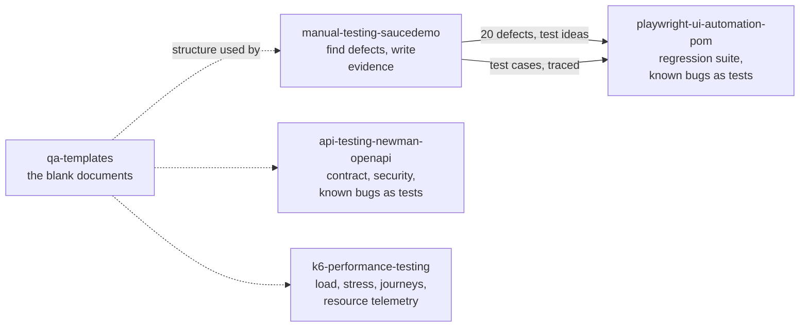

# SQA Portfolio

[](https://github.com/jahidulislamrihan26/sqa-portfolio/actions/workflows/ci.yml)

Software quality assurance work by **Md. Jahidul Islam Rihan**, as a set of standalone projects. Each one has its own repository, its own CI, its own documentation and, where it produces one, its own live report. Every number below was measured by running the tests; nothing is estimated.

**[Open the hub page](https://jahidulislamrihan26.github.io/sqa-portfolio/)** with links to every live report.

## The projects

| Project | Target | What it shows | Headline result |
|---|---|---|---|
| [**manual-testing-saucedemo**](https://github.com/jahidulislamrihan26/manual-testing-saucedemo) | [saucedemo.com](https://www.saucedemo.com) (web shop) | Risk-based strategy and plan, 87 test cases, traceability matrix, 6 exploratory charters, defect reports with evidence, summary report | 87 cases run: 60 pass, 27 fail. **20 defects** (11 genuine), including a login bypass with a forged cookie, a cart that keyboard users cannot open, and checkout accepting empty or repeated orders. Verdict: not ready for release |
| [**api-testing-newman-openapi**](https://github.com/jahidulislamrihan26/api-testing-newman-openapi) · [live report](https://jahidulislamrihan26.github.io/api-testing-newman-openapi/) | [Restful-Booker](https://restful-booker.herokuapp.com) (booking API) | Postman and Newman suite built on an OpenAPI 3 spec: schema contract checks, auth, a 14-body validation matrix, HTTP behaviour (ETag, 304, 415, 406), security checks, data-driven runs, coverage report, self-cleaning test data | 186 assertions: 151 pass, 35 expected failures, **0 unexpected**; all 23 documented responses covered. **13 defects**, e.g. invalid dates stored as `0NaN-aN-aN`, decimals truncated, failed login returns 200 |
| [**k6-performance-testing**](https://github.com/jahidulislamrihan26/k6-performance-testing) · [live report](https://jahidulislamrihan26.github.io/k6-performance-testing/) | Real demo shop (Node.js and SQLite, run locally, nothing simulated) | k6 smoke, load, shopper-journey, stress, spike and soak tests; per-endpoint targets; CPU and event-loop telemetry that proves the cause; recommendations | 400 req/s: p95 17 ms. 5,110 shopper journeys, 100% correct. Healthy to **at least 900 req/s** (up to about 2,300 in the best run; capacity varied 2x between runs and the report says so). Latency first, then refused connections; recovers fully. Cause: one CPU-bound process |
| [**playwright-ui-automation-pom**](https://github.com/jahidulislamrihan26/playwright-ui-automation-pom) · [live report](https://jahidulislamrihan26.github.io/playwright-ui-automation-pom/) | [saucedemo.com](https://www.saucedemo.com) | Playwright and TypeScript with the **Page Object Model**, fixtures, tests linked to manual cases, keyboard and accessibility tests, expected-failure tests for all known bugs, lint, run summary | 115 tests on **Chromium, Firefox, WebKit and a phone profile**; **82 of 87 manual cases automated (94%)**; 345 runs with 0 flaky. Its keyboard test found a Critical defect (the cart cannot be opened by keyboard) that the accessibility scan missed |
| [**qa-templates**](https://github.com/jahidulislamrihan26/qa-templates) | Any project | Ready-to-use test strategy, plan, test case, bug report, summary report, exploratory charter and risk templates; accessibility, API, security, performance and release checklists; worked examples | A kit a team can copy and use on day one |

## How the projects connect

The defects found by hand in the manual project reappear as expected-failure tests in the automation project, and the same idea (a test that states the *correct* behaviour and is allowed to fail until the bug is fixed) is used in the API project. CI stays green only for known problems and turns red for anything new. The automation repository keeps a snapshot of the manual test cases and builds a traceability table showing which ones are automated.

## Where to start
- **Quick read (5 minutes):** the summary reports: [manual](https://github.com/jahidulislamrihan26/manual-testing-saucedemo/blob/main/docs/05-test-summary-report.md), [API](https://github.com/jahidulislamrihan26/api-testing-newman-openapi/blob/main/docs/test-summary-report.md), [performance](https://github.com/jahidulislamrihan26/k6-performance-testing/blob/main/docs/test-summary-report.md).
- **See the code structure:** [page objects](https://github.com/jahidulislamrihan26/playwright-ui-automation-pom/tree/main/pages) and [fixtures](https://github.com/jahidulislamrihan26/playwright-ui-automation-pom/tree/main/fixtures).
- **See evidence:** [defect reports with screenshots](https://github.com/jahidulislamrihan26/manual-testing-saucedemo/tree/main/defects), [API defect reports](https://github.com/jahidulislamrihan26/api-testing-newman-openapi/blob/main/docs/defects/README.md), the [Excel test suite](https://github.com/jahidulislamrihan26/manual-testing-saucedemo/blob/main/test-suite/SauceDemo-Test-Suite.xlsx).
- **Use something:** the [templates and checklists](https://github.com/jahidulislamrihan26/qa-templates).

## Run them yourself
Each repository's README has the exact commands. All need Node 20 or newer (the performance project needs 22.13 or newer) and the performance project also needs [k6](https://k6.io/docs/get-started/installation/).
```bash
git clone https://github.com/jahidulislamrihan26/api-testing-newman-openapi && cd api-testing-newman-openapi && npm install && npm test
git clone https://github.com/jahidulislamrihan26/playwright-ui-automation-pom && cd playwright-ui-automation-pom && npm install && npx playwright install chromium && npm test
```

CI (GitHub Actions) in each repository runs its tests on every push, and nightly where the target is a public site.

## History
Before being split into separate repositories, all of this lived in this one. That earlier history is kept here, and each new repository also carries the history of its own project.

## License
Released under the [MIT License](LICENSE). Copyright (c) 2026 Md. Jahidul Islam Rihan.
