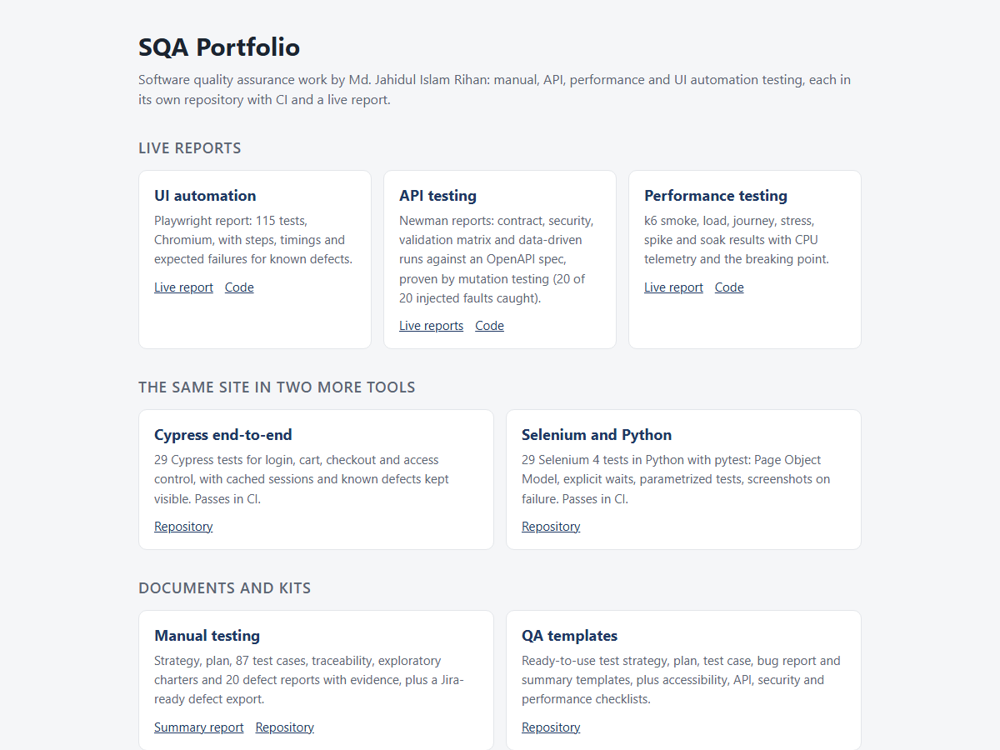
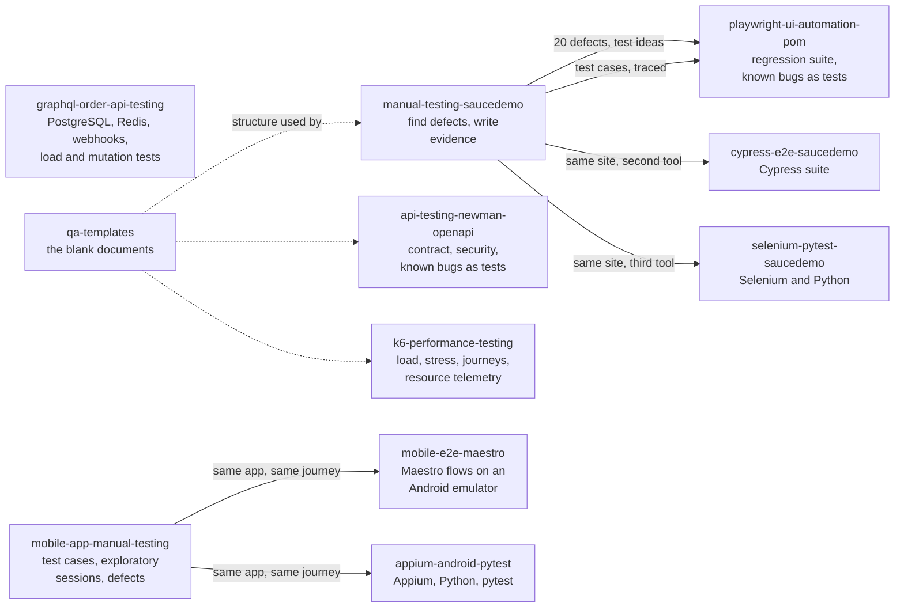

# SQA Portfolio

[](https://github.com/jahidulislamrihan26/sqa-portfolio/actions/workflows/ci.yml)

Software quality assurance work by **Md. Jahidul Islam Rihan**, as a set of standalone projects. Each one has its own repository, its own CI, its own documentation and, where it produces one, its own live report. Every number below was measured by running the tests; nothing is estimated.

**[Open the hub page](https://jahidulislamrihan26.github.io/sqa-portfolio/)** with links to every live report.

[](https://jahidulislamrihan26.github.io/sqa-portfolio/)

## The projects

| Project | Target | What it shows | Headline result |
|---|---|---|---|
| [**manual-testing-saucedemo**](https://github.com/jahidulislamrihan26/manual-testing-saucedemo) | [saucedemo.com](https://www.saucedemo.com) (web shop) | Risk-based strategy and plan, 87 test cases, traceability matrix, 6 exploratory charters, defect reports with evidence, summary report | 87 cases run: 60 pass, 27 fail. **20 defects** (11 genuine), including a login bypass with a forged cookie, a cart that keyboard users cannot open, and checkout accepting empty or repeated orders. Verdict: not ready for release |
| [**api-testing-newman-openapi**](https://github.com/jahidulislamrihan26/api-testing-newman-openapi) · [live report](https://jahidulislamrihan26.github.io/api-testing-newman-openapi/) | [Restful-Booker](https://restful-booker.herokuapp.com) (booking API) | Postman and Newman suite built on an OpenAPI 3 spec: schema contract checks, auth, a 14-body validation matrix, HTTP behaviour (ETag, 304, 415, 406), security checks, data-driven runs, coverage report, self-cleaning test data | 186 assertions: 151 pass, 35 expected failures, **0 unexpected**; all 23 documented responses covered. **Mutation-tested: 20 of 20 injected faults caught** by the suite. **13 defects**, e.g. invalid dates stored as `0NaN-aN-aN`, decimals truncated, failed login returns 200 |
| [**k6-performance-testing**](https://github.com/jahidulislamrihan26/k6-performance-testing) · [live report](https://jahidulislamrihan26.github.io/k6-performance-testing/) | Real demo shop (Node.js and SQLite, run locally, nothing simulated) | k6 smoke, load, shopper-journey, stress, spike and soak tests; per-endpoint targets; CPU and event-loop telemetry that proves the cause; recommendations | 400 req/s: p95 17 ms. 5,110 shopper journeys, 100% correct. Healthy to **at least 900 req/s** (up to about 2,300 in the best run; capacity varied 2x between runs and the report says so). Latency first, then refused connections; recovers fully. Cause: one CPU-bound process. **20 SQL checks** on the shop database found it never reduces stock (the shop can oversell) |
| [**playwright-ui-automation-pom**](https://github.com/jahidulislamrihan26/playwright-ui-automation-pom) · [live report](https://jahidulislamrihan26.github.io/playwright-ui-automation-pom/) | [saucedemo.com](https://www.saucedemo.com) | Playwright and TypeScript with the **Page Object Model**, fixtures, tests linked to manual cases, keyboard and accessibility tests, expected-failure tests for all known bugs, lint, run summary | 115 tests on **Chromium, Firefox, WebKit and a phone profile**; **82 of 87 manual cases automated (94%)**; 345 runs with 0 flaky. Its keyboard test found a Critical defect (the cart cannot be opened by keyboard) that the accessibility scan missed |
| [**cypress-e2e-saucedemo**](https://github.com/jahidulislamrihan26/cypress-e2e-saucedemo) · [live report](https://jahidulislamrihan26.github.io/cypress-e2e-saucedemo/) | [saucedemo.com](https://www.saucedemo.com) | Cypress end-to-end tests: cached sessions, page helpers, no fixed waits, accessibility scan, 5 screen sizes, the faulty test users, known defects kept visible, linked to the manual suite by a generated traceability table | **94 tests**, all passing in CI in about a minute; **74 of 87 manual cases automated (85%)**; 18 of 20 known defects captured |
| [**selenium-pytest-saucedemo**](https://github.com/jahidulislamrihan26/selenium-pytest-saucedemo) · [live reports](https://jahidulislamrihan26.github.io/selenium-pytest-saucedemo/) | [saucedemo.com](https://www.saucedemo.com) | Selenium 4 in Python with pytest: Page Object Model, explicit waits only, parametrized tests, **Chrome and Firefox** in parallel, real keyboard tests, axe-core accessibility scan, known defects as strict expected failures, traceability table | **104 tests**; **80 of 87 manual cases automated (92%)**; **all 20 known defects captured**, including the two only a keyboard test can find |
| [**graphql-order-api-testing**](https://github.com/jahidulislamrihan26/graphql-order-api-testing) | A GraphQL order service I built (Node.js, **PostgreSQL**, **Redis**) | API tests for an order and checkout backend: the whole order state machine, signed payment and shipping webhooks (bad signature, replay, duplicates, out-of-order events), cancellations and returns, concurrency, Redis cart and rate limiting. k6 load tests with a bottleneck analysis, SQL data-integrity checks after the load, and mutation testing | **124 tests** against real PostgreSQL and Redis in CI. **Mutation-tested: 20 of 20 injected faults caught.** Healthy to about **2,000 requests per second** on a small runner; the first limit is the single Node.js process, not the database. 9 integrity checks pass on 586 orders after the load |
| [**mobile-e2e-maestro**](https://github.com/jahidulislamrihan26/mobile-e2e-maestro) | My Demo App (React Native, by Sauce Labs) on an Android emulator | Mobile end-to-end tests with **Maestro**: reusable subflows, smoke and regression tags, a real emulator in GitHub Actions, JUnit reports, a flakiness measurement and a negative control that must fail | **10 flows**, all passing in about 5.5 minutes, including a full purchase. Smoke flows repeated 10 times: **40 of 40 passed**, no flaky test. Android only so far: not run on iOS or real devices |
| [**mobile-app-manual-testing**](https://github.com/jahidulislamrihan26/mobile-app-manual-testing) | My Demo App (React Native, by Sauce Labs) on an Android emulator | Manual mobile test package: strategy, 38 test cases with results, exploratory sessions, device compatibility plan, defect reports with screenshots and a video, Excel workbook, Jira import file, QA summary report | 32 cases executed: 24 pass, 8 fail. **8 defects** (1 Critical, 3 Major, 3 Minor, 1 Cosmetic), e.g. Back after an order opens a checkout screen with an empty cart, and Place Order confirms an order with no items; the full card number is shown on the review screen. Verdict: not ready for release. Android emulator only: no iOS, no real devices |
| [**appium-android-pytest**](https://github.com/jahidulislamrihan26/appium-android-pytest) | The same app on an Android emulator | Appium 3 (UiAutomator2) with Python and pytest: Page Object Model, explicit waits only, smoke and regression markers, clean app state per test, screenshot on failure, emulator in GitHub Actions | **14 tests**, all passing in about 2 minutes in CI. Suite repeated 5 times: **70 of 70 passed**, no flaky test. A negative control (a wrong price) must fail, and does |
| [**qa-templates**](https://github.com/jahidulislamrihan26/qa-templates) | Any project | Ready-to-use test strategy, plan, test case, bug report, summary report, exploratory charter and risk templates; accessibility, API, security, performance and release checklists; worked examples | A kit a team can copy and use on day one |

## How the projects connect

The defects found by hand in the manual project reappear as expected-failure tests in the automation project, and the same idea (a test that states the *correct* behaviour and is allowed to fail until the bug is fixed) is used in the API project. CI stays green only for known problems and turns red for anything new. The automation repository keeps a snapshot of the manual test cases and builds a traceability table showing which ones are automated.

## Where to start
- **Quick read (5 minutes):** the summary reports: [manual](https://github.com/jahidulislamrihan26/manual-testing-saucedemo/blob/main/docs/05-test-summary-report.md), [API](https://github.com/jahidulislamrihan26/api-testing-newman-openapi/blob/main/docs/test-summary-report.md), [performance](https://github.com/jahidulislamrihan26/k6-performance-testing/blob/main/docs/test-summary-report.md).
- **See the code structure:** [page objects](https://github.com/jahidulislamrihan26/playwright-ui-automation-pom/tree/main/pages) and [fixtures](https://github.com/jahidulislamrihan26/playwright-ui-automation-pom/tree/main/fixtures) in Playwright, and the same Page Object idea in [Selenium with Python](https://github.com/jahidulislamrihan26/selenium-pytest-saucedemo/tree/main/pages).
- **See proof the tests catch bugs:** the [mutation report](https://github.com/jahidulislamrihan26/api-testing-newman-openapi/blob/main/docs/mutation-report.md) (20 injected faults, all caught).
- **See a backend with a database and a cache tested properly:** the [GraphQL order API tests](https://github.com/jahidulislamrihan26/graphql-order-api-testing) (webhooks, concurrency, load, mutation testing) and its [load test report](https://github.com/jahidulislamrihan26/graphql-order-api-testing/blob/main/docs/load-test-report.md).
- **See mobile testing:** the [Maestro flows](https://github.com/jahidulislamrihan26/mobile-e2e-maestro/tree/main/flows) and the [flaky-test policy](https://github.com/jahidulislamrihan26/mobile-e2e-maestro/blob/main/docs/conventions.md).
- **See manual mobile testing:** the [QA summary report](https://github.com/jahidulislamrihan26/mobile-app-manual-testing/blob/main/docs/04-qa-summary-report.md) and the [Critical defect report](https://github.com/jahidulislamrihan26/mobile-app-manual-testing/blob/main/defects/BUG-001.md) with its screenshot.
- **See Appium:** the [page objects](https://github.com/jahidulislamrihan26/appium-android-pytest/tree/main/pages) and [tests](https://github.com/jahidulislamrihan26/appium-android-pytest/tree/main/tests).
- **See evidence:** [defect reports with screenshots](https://github.com/jahidulislamrihan26/manual-testing-saucedemo/tree/main/defects), [API defect reports](https://github.com/jahidulislamrihan26/api-testing-newman-openapi/blob/main/docs/defects/README.md), the [Excel test suite](https://github.com/jahidulislamrihan26/manual-testing-saucedemo/blob/main/test-suite/SauceDemo-Test-Suite.xlsx).
- **Use something:** the [templates and checklists](https://github.com/jahidulislamrihan26/qa-templates).

## Run them yourself
Each repository's README has the exact commands. The Node projects need Node 20 or newer (the performance project needs 22.13 or newer, and also [k6](https://k6.io/docs/get-started/installation/)); the Selenium project needs Python 3.10 or newer and Chrome.
```bash
git clone https://github.com/jahidulislamrihan26/api-testing-newman-openapi && cd api-testing-newman-openapi && npm install && npm test
git clone https://github.com/jahidulislamrihan26/playwright-ui-automation-pom && cd playwright-ui-automation-pom && npm install && npx playwright install chromium && npm test
git clone https://github.com/jahidulislamrihan26/cypress-e2e-saucedemo && cd cypress-e2e-saucedemo && npm install && npx cypress install && npm test
```

CI (GitHub Actions) in each repository runs its tests on every push, and nightly where the target is a public site.

## History
Before being split into separate repositories, all of this lived in this one. That earlier history is kept here, and each new repository also carries the history of its own project.

## License
Released under the [MIT License](LICENSE). Copyright (c) 2026 Md. Jahidul Islam Rihan.
