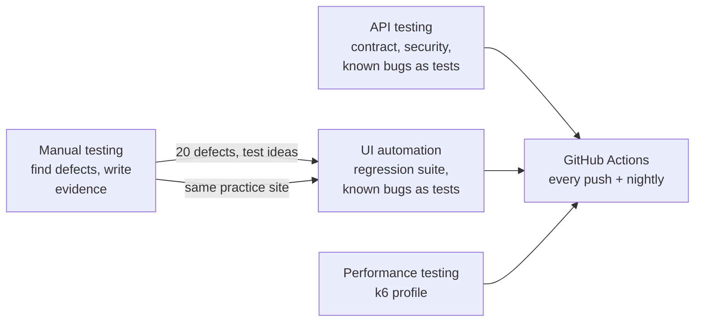

# SQA Portfolio

[](https://github.com/jahidulislamrihan26/sqa-portfolio/actions/workflows/ci.yml)

**[Open the live test reports](https://jahidulislamrihan26.github.io/sqa-portfolio/)** (UI, API and performance, regenerated on every push).

Four complete software-testing projects, from planning to reports to automated checks in CI. Each folder stands alone with its own README, plan, results and findings. Every number below was measured by running the tests; nothing is estimated.

## The four projects at a glance

| Project | Target | What it shows | Headline result |
|---|---|---|---|
| [**Manual testing**](manual-testing) | [saucedemo.com](https://www.saucedemo.com) (web shop) | Strategy, risk-based plan, 87 test cases, traceability matrix, 6 exploratory charters, defect reports with screenshots, summary report | 87 cases run: 60 pass, 27 fail. **20 defects** (11 genuine), including a login bypass with a forged cookie, a cart that keyboard users cannot open, and checkout accepting empty or repeated orders. Verdict: not ready for release |
| [**API testing**](api-testing) | [Restful-Booker](https://restful-booker.herokuapp.com) (booking API) | Postman and Newman suite built on an OpenAPI 3 spec I wrote: schema contract checks, auth, a 14-body validation matrix, HTTP behaviour (ETag, 304, 415, 406), security checks, data-driven runs, coverage report, self-cleaning test data | 186 assertions: 151 pass, 35 expected failures, **0 unexpected**; all 23 documented responses covered. **13 defects**, e.g. invalid dates stored as `0NaN-aN-aN`, decimals truncated, failed login returns 200 |
| [**Performance testing**](performance-testing) | Real demo shop (Node.js + SQLite, run locally, nothing simulated) | k6 smoke, load, shopper-journey, stress, spike and soak tests; per-endpoint targets; CPU and event-loop telemetry that proves the cause; recommendations | 400 req/s: p95 17 ms. 5,110 shopper journeys, 100% correct. Healthy to **at least 900 req/s** (up to about 2,300 in the best run; capacity varied 2x between runs and the report says so). Latency first, then refused connections; recovers fully. Cause: one CPU-bound process |
| [**UI automation**](automation-testing) | [saucedemo.com](https://www.saucedemo.com) | Playwright and TypeScript with the **Page Object Model**, fixtures, tests linked to manual cases, keyboard and accessibility tests, expected-failure tests for all known bugs, lint, run summary | 115 tests on **Chromium, Firefox, WebKit and a phone profile**; **82 of 87 manual cases automated (94%)**; 339 runs with 0 flaky. Its keyboard test found a Critical defect (the cart cannot be opened by keyboard) that the accessibility scan missed |

## How the projects connect

The defects found by hand in the manual project reappear as expected-failure tests in the automation project, and the same idea (a test that states the *correct* behaviour and is allowed to fail until the bug is fixed) is used in the API project. CI stays green only for known problems and turns red for anything new.

## Where to start
- **Quick read (5 minutes):** [manual test summary](manual-testing/docs/05-test-summary-report.md), [API summary](api-testing/docs/test-summary-report.md), [performance summary](performance-testing/docs/test-summary-report.md).
- **See the code structure:** [page objects](automation-testing/pages) and [fixtures](automation-testing/fixtures).
- **Open the live reports:** [UI](https://jahidulislamrihan26.github.io/sqa-portfolio/ui/playwright-report/index.html), [API](https://jahidulislamrihan26.github.io/sqa-portfolio/api/functional-report.html), [performance](https://jahidulislamrihan26.github.io/sqa-portfolio/performance/).
- **See evidence:** [defect reports with screenshots](manual-testing/defects), [API defect reports](api-testing/docs/defects/README.md), [Excel workbook](manual-testing/test-suite/SauceDemo-Test-Suite.xlsx).

## Run it yourself
Needs Node 20 or newer (the performance project needs Node 22.13 or newer, because its shop uses Node's built-in SQLite) and [k6](https://k6.io/docs/get-started/installation/).
```bash
cd api-testing && npm install && npm test                     # API suite, writes HTML and JUnit reports
cd performance-testing && npm test                            # about 20 minutes; npm run test:ci is the short profile
cd automation-testing && npm install && npx playwright install chromium && npm test
cd manual-testing/tools && npm install && npm run build       # regenerates the Excel workbook and reports
```

CI (GitHub Actions) runs the API suite, the UI suite on three browsers and a short performance profile on every push and nightly.

## License
Released under the [MIT License](LICENSE). Copyright (c) 2026 Md. Jahidul Islam Rihan.
