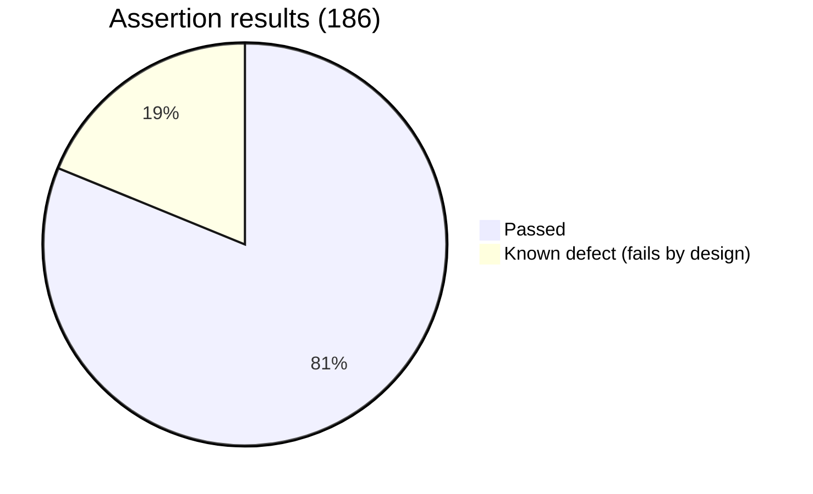
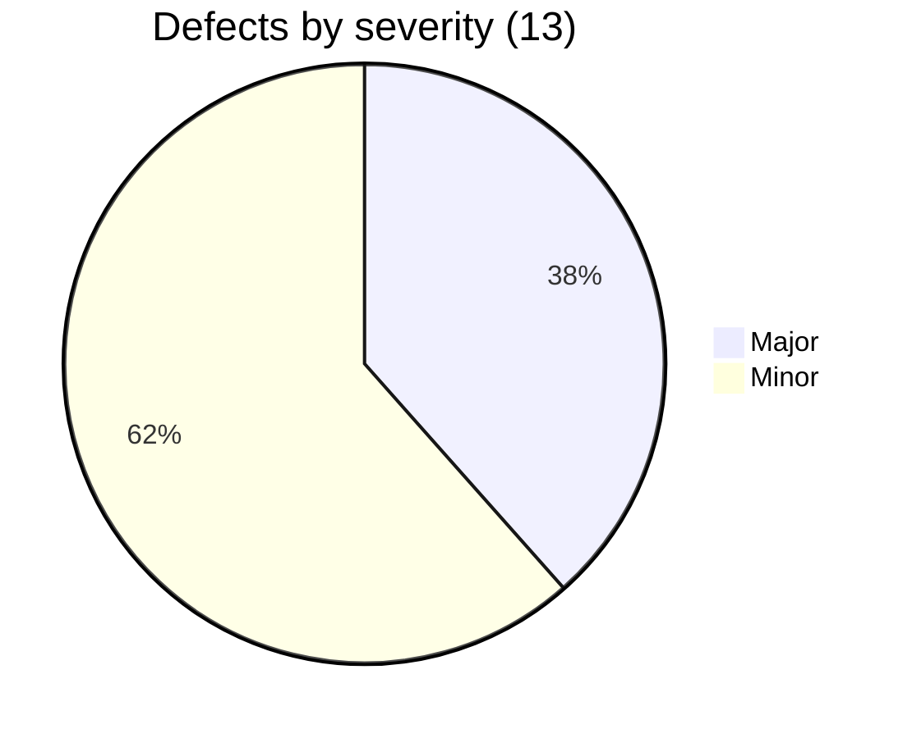

# API Test Summary Report: Restful-Booker

| | |
|---|---|
| API | https://restful-booker.herokuapp.com |
| Run date | 2026-11-05 |
| Tool | Newman 6 running a Postman collection built from an OpenAPI 3 specification |
| Detailed results | [Live HTML reports](https://jahidulislamrihan26.github.io/sqa-portfolio/api/functional-report.html), `reports/*.html`, `reports/summary.json` |

## 1. Executive summary
Core booking behaviour is correct: create, read, update, patch and delete work, valid data round-trips exactly, responses match their JSON Schemas, conditional requests (ETag and 304) work, unknown fields are ignored (no mass assignment), and unauthorised changes are blocked with 403. The API is fast (average 282 to 327 ms across three runs).

The weak area is **input validation and error handling**, and the deeper testing in this version showed it is worse than first thought. The API accepts impossible data and **silently changes valid-looking data**: an invalid date is stored as the text `0NaN-aN-aN`, the price `99.99` is saved as `99`, and `03/03/2031` is reinterpreted as a month/day date. It returns **500** for null or wrong-type values and for a wrong `Content-Type`, signals a failed login with **200 OK**, is reachable over plain **HTTP**, and answers an unsupported `Accept` header with **418 "I'm a Teapot"**. Thirteen defects were found; five are Major.

**Recommendation:** fix API-BUG-001, 002, 004, 008 and 012 before this API holds real customer data. API-BUG-012 (silent data corruption) is the most important new finding.

## 2. Results
| Measure | Value |
|---|---|
| Requests in the collection | 74 (9 folders) |
| Requests sent in a run (includes data rows) | 102 |
| Assertions executed | 186 |
| Passed | 151 |
| Expected failures (known defects) | 35 |
| Unexpected failures | **0** |
| Documented responses asserted | 23 of 23 ([coverage](api-coverage.md)) |
| Average response time | 282 to 327 ms (3 runs); p95 363 to 495 ms |
| Test data created and removed | 23 / 23 |
| Stability | 3 consecutive runs, identical results |

**Validation matrix (14 bodies):** 12 expose a defect, 2 behave correctly (a very large price and Unicode/emoji names are stored exactly).

## 3. Findings
| ID | Title | Severity | Failing tests |
|---|---|---|---|
| [API-BUG-012](defects/API-BUG-012.md) | Invalid dates stored as "0NaN-aN-aN"; decimals truncated; slash dates reformatted | **Major** | VAL-01 (3 rows) |
| [API-BUG-001](defects/API-BUG-001.md) | Failed login returns 200 OK instead of 401 | Major | AUTH-02, 03, 04 |
| [API-BUG-002](defects/API-BUG-002.md) | Missing, null or wrong-type values cause 500 | Major | CRT-05, 06, VAL-01 (6 rows) |
| [API-BUG-004](defects/API-BUG-004.md) | No business-rule validation on booking data | Major | CRT-07, 08, 09, 10, HTTP-19, VAL-01 (3 rows) |
| [API-BUG-008](defects/API-BUG-008.md) | Served over plain HTTP, no redirect | Major | SEC-04 |
| [API-BUG-010](defects/API-BUG-010.md) | Wrong Content-Type on create causes 500 instead of 415 | Minor | HTTP-06, 07 |
| [API-BUG-011](defects/API-BUG-011.md) | Unsupported Accept returns 418 "I'm a Teapot" instead of 406 | Minor | HTTP-08, 20 |
| [API-BUG-013](defects/API-BUG-013.md) | Booking ids read leniently: 1.5, 1abc, +1 return booking 1 | Minor | HTTP-11, 11B |
| [API-BUG-003](defects/API-BUG-003.md) | Invalid date filter causes 500 | Minor | RD-09 |
| [API-BUG-005](defects/API-BUG-005.md) | 405 instead of 404 on deleted booking | Minor | DEL-05, 06 |
| [API-BUG-006](defects/API-BUG-006.md) | Error responses are plain text | Minor | RD-10 |
| [API-BUG-007](defects/API-BUG-007.md) | XML labelled text/html | Minor | RD-08 |
| [API-BUG-009](defects/API-BUG-009.md) | X-Powered-By discloses framework | Minor | SEC-05 |

## 4. What works well
- Authorisation: PUT, PATCH and DELETE without a valid token or Basic header return 403 and leave the booking unchanged; Bearer tokens, a wrong cookie name and a wrong Basic value are also refused.
- SQL injection in login and in the filter does not authenticate or return data; script text is stored as inert JSON text; 500 responses do not leak stack traces.
- No mass assignment: extra fields such as `admin` or `bookingid` on create or patch are ignored.
- HTTP behaviour: HEAD returns headers and no body, OPTIONS lists the allowed methods, ETag and conditional GET return 304, repeating the same PUT gives the same result.
- Unicode, emoji, apostrophes, zero and very large prices round-trip exactly.
- PUT with missing fields correctly returns 400 (but POST does not, see API-BUG-002).

## 5. Observations accepted as documented or harmless behaviour
- `/ping` and a successful `DELETE` return **201 Created**. Unusual, but stated in the API documentation, so asserted as-is and not logged as defects.
- A non-numeric booking id returns 404 rather than 400. Acceptable.
- The check-in filter is strictly "later than" (an equal date is excluded), and name filters are case sensitive. Asserted as observed and written into the spec.
- Paths are matched case-insensitively (`/Booking/12` works). Asserted as observed.
- The API sends no CORS headers, so browser apps on other origins cannot call it; fine for server-to-server use.

## 6. Limitations
- Token expiry, rate limiting and concurrency races were not tested.
- Load behaviour is covered separately in the `performance-testing` project.
- The API is a shared public service; results can differ if it is reset or changed. One early test used a hardcoded booking that another user had deleted and was fixed to use only its own data.
- The OpenAPI file was written by the tester; it is not published by the API owner.

## 7. Next steps
1. Developers triage the thirteen defects; on each fix the matching KNOWN-BUG test will start passing and the runner will report it.
2. Ask the API owner to publish their own OpenAPI file and compare it with this one.
3. Add token-expiry and rate-limit tests once their rules are documented.
