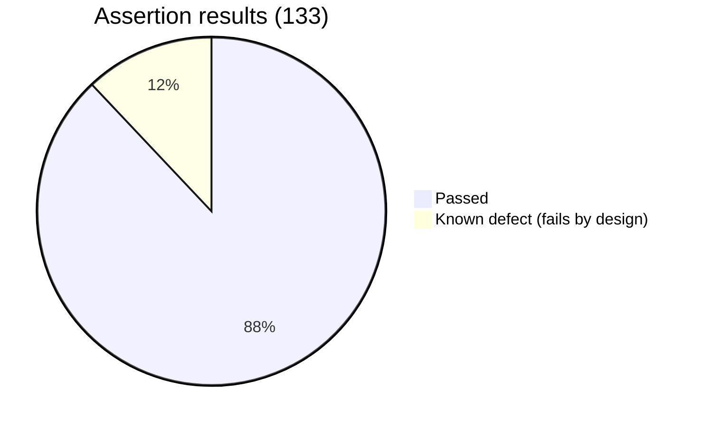
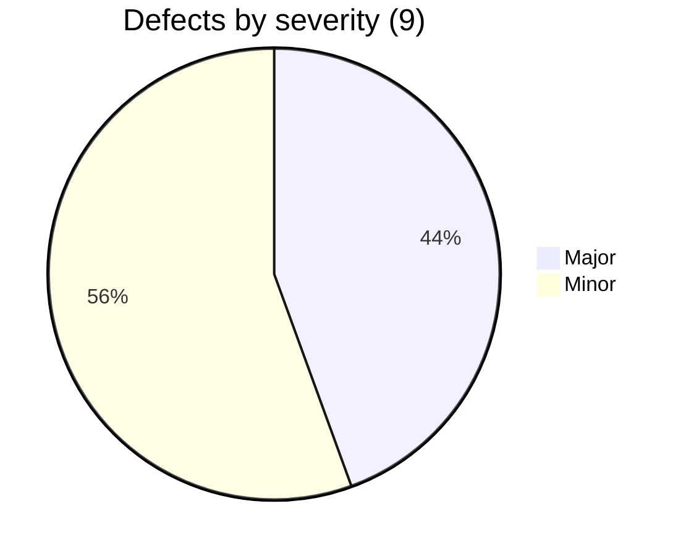

# API Test Summary Report: Restful-Booker

| | |
|---|---|
| API | https://restful-booker.herokuapp.com |
| Run date | 2026-11-05 |
| Tool | Newman 6 running a Postman collection |
| Detailed results | `reports/functional-report.html`, `reports/data-driven-report.html`, `reports/summary.json` |

## 1. Executive summary
Core booking behaviour is correct: create, read, update, patch and delete work, data round-trips exactly, responses match their JSON Schemas, and unauthorised changes are blocked with 403. The API is fast (average 264 ms, p95 324 ms).

The weak area is **input validation and error handling**. The API accepts impossible data (negative prices, check-out before check-in, 10,000-character names), returns **500** for bad client input, signals a failed login with **200 OK**, and is reachable over plain **HTTP**. Nine defects were found; four are Major.

**Recommendation:** fix API-BUG-001, 002, 004 and 008 before this API is used by real customers.

## 2. Results
| Measure | Value |
|---|---|
| Requests in collection | 49 |
| Requests sent (includes 6 data rows) | 64 |
| Assertions executed | 133 |
| Passed | 117 |
| Expected failures (known defects) | 16 |
| Unexpected failures | **0** |
| Average / p95 response time | 264 ms / 324 ms |
| Test data created and removed | 14 / 14 |

## 3. Findings
| ID | Title | Severity | Failing tests |
|---|---|---|---|
| [API-BUG-001](defects/API-BUG-001.md) | Failed login returns 200 OK instead of 401 | Major | AUTH-02, 03, 04 |
| [API-BUG-002](defects/API-BUG-002.md) | Missing required fields cause 500 | Major | CRT-05, 06 |
| [API-BUG-003](defects/API-BUG-003.md) | Invalid date filter causes 500 | Minor | RD-09 |
| [API-BUG-004](defects/API-BUG-004.md) | No business-rule validation on booking data | Major | CRT-07, 08, 09, 10 |
| [API-BUG-005](defects/API-BUG-005.md) | 405 instead of 404 on deleted booking | Minor | DEL-05, 06 |
| [API-BUG-006](defects/API-BUG-006.md) | Error responses are plain text | Minor | RD-10 |
| [API-BUG-007](defects/API-BUG-007.md) | XML labelled text/html | Minor | RD-08 |
| [API-BUG-008](defects/API-BUG-008.md) | Served over plain HTTP, no redirect | Major | SEC-04 |
| [API-BUG-009](defects/API-BUG-009.md) | X-Powered-By discloses framework | Minor | SEC-05 |

## 4. What works well
- Authorisation: PUT, PATCH and DELETE without a valid token or Basic header return 403 and leave the booking unchanged (UPD-05..08, DEL-01..02, SEC-06).
- SQL injection in login and in the filter does not authenticate or return data (AUTH-05, SEC-01).
- Script text is stored as inert JSON text (SEC-02), and 500 responses do not leak stack traces (SEC-03).
- Unicode, apostrophes, zero and large prices round-trip correctly (DD-01..03).

## 5. Observations accepted as documented behaviour
- `/ping` and a successful `DELETE` return **201 Created**. Unusual, but stated in the API documentation, so asserted as-is and not logged as defects.
- A non-numeric booking id returns 404 rather than 400. Acceptable, not logged.

## 6. Limitations
- Token expiry, rate limiting and concurrency were not tested.
- Load behaviour is covered separately in the `performance-testing` project.
- The API is a shared public service; results can differ if it is reset or changed.

## 7. Next steps
1. Developers triage the nine defects; on each fix the matching KNOWN-BUG test will start passing and the runner will report it.
2. Add an OpenAPI description and validate responses against it.
3. Add token-expiry and rate-limit tests once their rules are documented.
