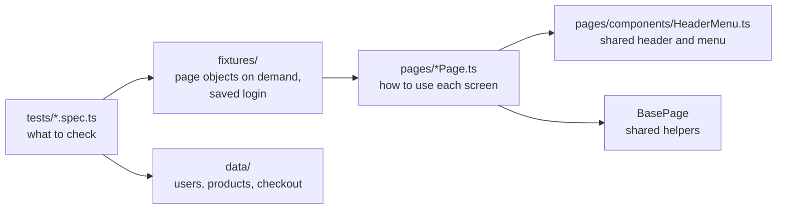

# UI Automation Project: Playwright + TypeScript + Page Object Model

A maintainable UI test framework for https://www.saucedemo.com. It shows how to structure automation so tests read like plain English, one change in the site means one fix in the code, and failures explain themselves.

## Result in one look
| | |
|---|---|
| Tests | **69** (plus a one-time login setup) in 7 spec files |
| Browsers | Chromium, Firefox, WebKit (Safari engine), run in a CI matrix |
| Tags | `@smoke` (11), `@regression`, `@a11y` (4), `@known-bug` (12) |
| Known site bugs | 12 expected-failure tests, each linked to a defect from the manual-testing project |
| Accessibility | axe-core scan of 4 pages, fails on any critical violation |
| Stability | Every test was run three times in a row on Chromium to look for flaky tests: after fixing two races (see below) all 208 runs passed |

## How it is organised

| Layer | Rule |
|---|---|
| **Tests** | Describe behaviour and contain the assertions. No selectors. |
| **Page objects** | Hold the selectors and actions of one screen (`InventoryPage.addToCart(...)`). Return data; tests decide what is right. |
| **Component** | `HeaderMenu` (cart badge, side menu) is written once and reused by every page. |
| **Fixtures** | Give each test the page objects it asks for, and a ready-made "shop with these items in the cart". |
| **Data** | Users, expected catalogue and form data live in `data/`, not inside tests. |

```
automation-testing/
  pages/            LoginPage, InventoryPage, ProductDetailPage, CartPage, Checkout*Page, BasePage
    components/     HeaderMenu
  fixtures/         index.ts  (test.extend with page objects, STANDARD_STATE)
  data/             users.ts, products.ts, checkout.ts
  tests/            auth.setup, login, inventory, cart, checkout, personas, accessibility, responsive
  playwright.config.ts   projects, reporters, retries, traces
```

## Techniques used
- **Login once, reuse everywhere.** A setup project signs in and saves the session; most tests start already logged in, which makes the suite faster and the tests shorter. Login tests opt out.
- **Data-driven tests.** Nine login rejections, three missing-field checks and six product detail pages run from tables.
- **Independent expected values.** The totals test adds up prices and the 8% tax itself instead of trusting the page.
- **Tags** run slices: `npm run test:smoke`, `test:regression`, `test:a11y`.
- **Known bugs are tests, not comments.** A `@known-bug` test states the correct behaviour and is marked `test.fail()`. It passes while the bug exists. When the site is fixed, Playwright reports "expected to fail but passed", telling the team to remove the annotation. This keeps CI green only for known problems and red for anything new.
- **Responsive checks** at phone, tablet and desktop sizes.
- **Diagnostics:** screenshot and video on failure, trace on first retry, JUnit and HTML reports, GitHub annotations in CI.
- **Type safety:** strict TypeScript, checked in CI (`npm run typecheck`).

## Known bugs covered
| Test | Defect |
|---|---|
| Reset App State restores "Add to cart" | BUG-003 |
| Empty cart cannot be checked out | BUG-001 |
| Letters rejected in postal code, whitespace rejected | BUG-002 |
| problem_user: unique images, sorting, add to cart, last name | BUG-004, 005, 006, 007 |
| error_user: no sort alert, add to cart | BUG-008, 009 |
| performance_glitch_user: products within 3 s | BUG-012 |
| visual_user: prices match catalogue | BUG-011 |

Details are in [the manual-testing defect reports](../manual-testing/defects).

## Run it
```bash
npm install
npx playwright install chromium      # once
npm test                             # all tests on Chromium
npm run test:smoke                   # 11 quick checks
npm run test:all-browsers            # Chromium, Firefox and WebKit (install them first)
npm run typecheck
npm run report                       # open the HTML report
```
Set `BASE_URL` to test another environment and `SAUCE_PASSWORD` to change the shared password.

## Lessons recorded in the code
Two tests were flaky at first, and both had the same cause: acting right after the address changed but before the page had drawn. The fix lives in the page objects (wait for something visible before asserting), so every test benefits. The empty-cart known-bug test waits up to 3 s for a wrong navigation, so it asserts "this never happens" without racing the page.

## Limits
- The accessibility scan finds only part of the problems and does not replace a manual screen-reader check. Only critical violations fail; the rest are attached to the report.
- Locally verified on Chromium. Firefox and WebKit run in CI.
- Targets a public practice site; if it changes, the nightly CI run will show it.
