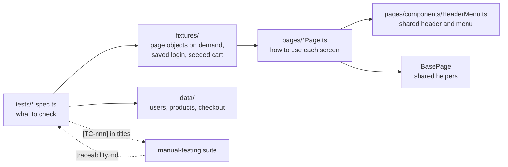

# UI Automation Project: Playwright + TypeScript + Page Object Model

A maintainable UI test framework for https://www.saucedemo.com. It shows how to structure automation so tests read like plain English, one change in the site means one fix in the code, every test points back to the manual test case it automates, and failures explain themselves.

## Result in one look
| | |
|---|---|
| Tests | **115** in 10 spec files, plus a one-time login setup |
| Traceability | **82 of 87 manual test cases (94%) automated** and 86 of 87 counting the browser matrix; each test links to its manual case, see [docs/traceability.md](docs/traceability.md) |
| Known site defects | **30 expected-failure tests** that capture **all 20** defects found by the manual project |
| Browsers and devices | Chromium, Firefox, WebKit (Safari's engine) and a Pixel 7 phone profile in CI; real Microsoft Edge 156 locally |
| Stability | Every test run 3 times in a row: **339 runs, 0 flaky, 0 unexpected failures**. A nightly CI job repeats this 5 times |
| Quality gates | Strict TypeScript, ESLint with Playwright rules (zero warnings allowed), traceability document checked for staleness |
| Accessibility | axe-core scan of all 7 pages **and** direct keyboard tests (the scan alone missed a keyboard blocker) |

## What it found that nothing else did
While writing the keyboard tests I discovered that the cart icon **cannot be reached with Tab and does nothing on Enter or Space** (it is an `<a role="button">` with no `href`). A keyboard-only shopper cannot open the cart or check out: **BUG-020, Critical**. The automated accessibility scan reported no violation, and so had my first manual keyboard pass. The defect was added to the [manual project](../manual-testing/defects/BUG-020.md) and the test that captures it is `[TC-086]` in [keyboard.spec.ts](tests/keyboard.spec.ts).

## How it is organised

| Layer | Rule |
|---|---|
| **Tests** | Describe behaviour and contain the assertions. No selectors. |
| **Page objects** | Hold the selectors and actions of one screen. `expectSomething()` methods wrap assertions about that screen. |
| **Component** | `HeaderMenu` (cart badge, side menu) is written once and reused by every page. |
| **Fixtures** | Give each test the page objects it asks for, a saved login, a cart written straight into storage, and `completeOrder(...)`. |
| **Data** | Users, the expected catalogue, product ids and form data live in `data/`, not inside tests. |

Full conventions, naming rules and a "how to add a test" checklist: [docs/test-design.md](docs/test-design.md).

```
automation-testing/
  pages/            LoginPage, InventoryPage, ProductDetailPage, CartPage, Checkout*Page, BasePage
    components/     HeaderMenu
  fixtures/         index.ts  (test.extend with page objects, STANDARD_STATE, shopWithCart, completeOrder)
  data/             users.ts, products.ts, checkout.ts
  tests/            auth.setup, login, inventory, cart, checkout, personas, security, navigation, keyboard,
                    accessibility, responsive
  tools/            trace.js (manual-to-automated traceability), summary.js (run summary)
  docs/             test-design.md, traceability.md (generated)
  playwright.config.ts   projects, reporters, retries, traces
```

## Techniques used
- **Traceability by title.** `[TC-034]` in a test title links it to manual case TC-034 and `[BUG-003]` to its defect. `npm run trace` builds the coverage table from the real list of tests, and CI fails if the committed table is stale.
- **Login once, reuse everywhere.** A setup project signs in and saves the session; most tests start already signed in.
- **Fast setup through storage.** `shopWithCart(...)` writes the cart (a list of product ids) into the browser's storage instead of clicking "Add to cart" for each product. Tests of the Add button still click.
- **Data-driven tests.** Nine login rejections, three missing-field checks, six product pages, five screen sizes and more run from tables.
- **Independent expected values.** The totals tests add up prices and the 8% tax themselves instead of trusting the page.
- **Known bugs are tests, not comments.** A `@known-bug` test states the correct behaviour and is marked `test.fail()`. It passes while the bug exists. When the site is fixed, Playwright reports "expected to fail but passed", telling the team to remove the annotation. CI stays green only for known problems and turns red for anything new.
- **Tags** run slices: `npm run test:smoke`, `test:regression`, `test:a11y`, `test:security`, `test:known-bugs`.
- **Run summary.** `npm run summary` (and the job page in CI) shows passed, known defects, defects that now pass, flaky tests and the slowest tests.
- **Diagnostics:** screenshot and video on failure, trace on first retry, HTML, JUnit and JSON reports, GitHub annotations in CI.
- **Flakiness controls:** no fixed waits, retry-safe assertions, a nightly 5x repeat with no retries, and a rule written down for the two races found while building this (acting before the page was drawn; asserting "nothing happens" instantly).

## Known defects covered
| Test group | Defects |
|---|---|
| Standard user | BUG-001, 002, 003, 013 (forged session), 014, 015 (checkout state), 016 (focus not visible), 017, 018 (security headers), 019, **020 (cart keyboard blocker)** |
| problem_user | BUG-004, 005, 006, 007 |
| error_user | BUG-008, 009, 010 |
| visual_user, performance_glitch_user | BUG-011, BUG-012 |

Details are in [the manual-testing defect reports](../manual-testing/defects).

## Run it
```bash
npm install
npx playwright install chromium      # once
npm test                             # all tests on Chromium
npm run test:smoke                   # quick checks
npm run test:all-browsers            # Chromium, Firefox, WebKit and the phone profile (install them first)
npm run test:stability               # every test 5 times in a row
npm run summary                      # short summary of the last run
npm run trace                        # rebuild docs/traceability.md
npm run lint ; npm run typecheck
npm run report                       # open the HTML report
```
Real Microsoft Edge (if installed): `EDGE=1 npx playwright test --project=edge` (PowerShell: `$env:EDGE=1; npx playwright test --project=edge`).
Set `BASE_URL` to test another environment and `SAUCE_PASSWORD` to change the shared password.

## Lessons recorded in the code
- Two tests were flaky at first, both from acting right after the address changed but before the page had drawn. The fix lives in the page objects (wait for something visible before asserting).
- A test that "Escape closes the menu" failed because Escape pressed during the slide-open animation is ignored. The test now retries the key press, as a person would.
- A quick check of the cart link in the browser's inspector would have shown the missing `href`. The keyboard test found it only because it tried to reach the cart with Tab.

## Limits
- The accessibility scan finds only part of the problems and does not replace a manual screen-reader check. Only critical violations fail; the rest are attached to the report.
- No screenshot-comparison tests: baselines differ between operating systems. The one manual case that needs it (TC-058) stays manual.
- Locally verified on Chromium, Edge and the phone profile. Firefox and WebKit run in CI.
- Targets a public practice site; if it changes, the nightly CI run will show it.
