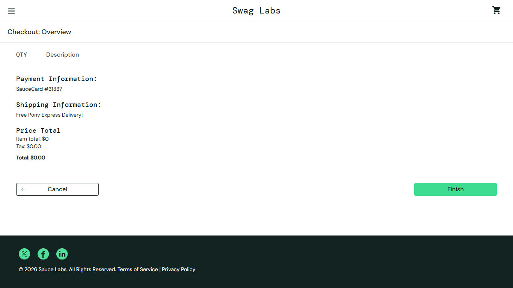

# BUG-001: Checkout can be started and completed with an empty cart

| Field | Value |
|---|---|
| Severity | Major |
| Priority | High |
| Module | Checkout |
| Origin | Genuine |
| Status | Open |
| Found in | https://www.saucedemo.com, Chrome (Chromium), 2026-11-05 |
| Test user | `standard_user / secret_sauce` |
| Failed test cases | TC-038 |

## Steps to reproduce
1. Log in as standard_user
2. Click the cart icon (cart is empty)
3. Click Checkout
4. Enter First Test, Last User, ZIP 12345
5. Click Continue

## Expected result
Checkout is blocked with a message such as "Your cart is empty".

## Actual result
Checkout step two opens with Total: $0.00 and a Finish button.

## Evidence

