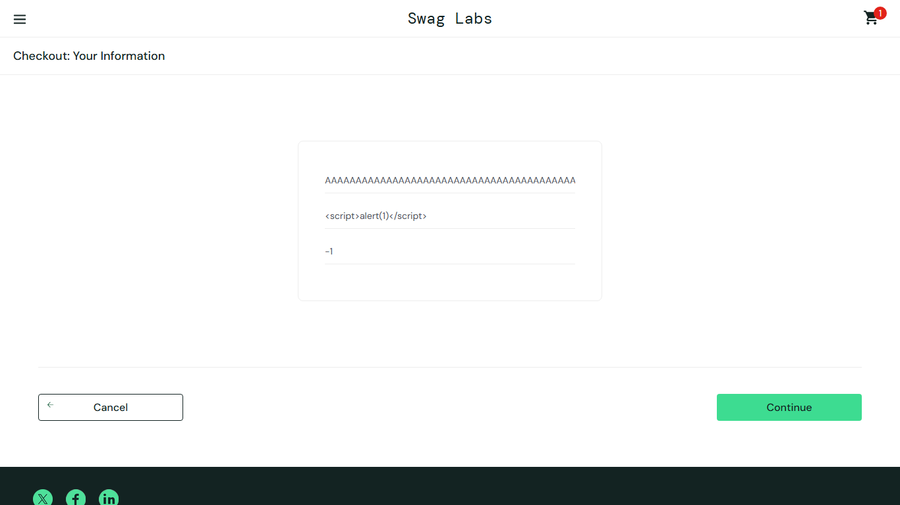

# BUG-002: Checkout form has no input validation beyond "required"

| Field | Value |
|---|---|
| Severity | Major |
| Priority | Medium |
| Module | Checkout |
| Origin | Genuine |
| Status | Open |
| Found in | https://www.saucedemo.com, Chrome (Chromium), 2026-11-05 |
| Test user | `standard_user / secret_sauce` |
| Failed test cases | TC-042, TC-043, TC-044 |

## Steps to reproduce
1. Add any product and start checkout
2. Enter first name of 300 "A", last name "", ZIP "-1" (also tried "abc!@#" and three spaces in each field)
3. Click Continue

## Expected result
Invalid ZIP, whitespace-only values and excessive length are rejected with a field error.

## Actual result
All variants accepted and checkout moved to the overview page. (Output encoding of the script text was not examined.)

## Evidence

