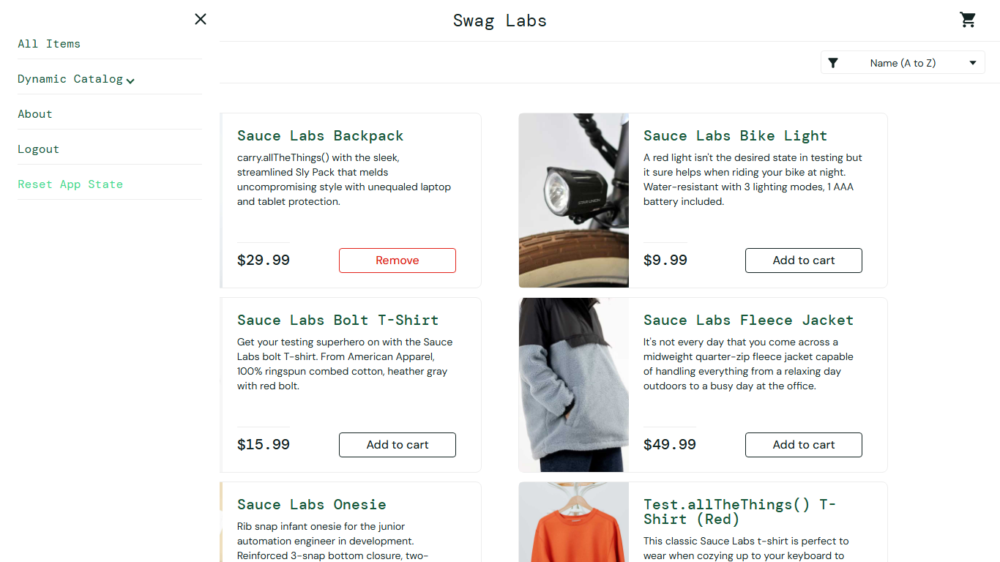

# BUG-003: Reset App State clears the cart badge but leaves product buttons on "Remove"

| Field | Value |
|---|---|
| Severity | Minor |
| Priority | Medium |
| Module | Cart |
| Origin | Genuine |
| Status | Open |
| Found in | https://www.saucedemo.com, Chrome (Chromium), 2026-11-05 |
| Test user | `standard_user / secret_sauce` |
| Failed test cases | TC-034 |

## Steps to reproduce
1. Log in as standard_user
2. Click Add to cart on Sauce Labs Backpack
3. Open the menu and click Reset App State
4. Look at the Backpack button

## Expected result
Cart badge cleared and button back to "Add to cart".

## Actual result
Badge cleared but the button still reads "Remove" while the cart is empty. The user cannot re-add the item without a page reload.

## Evidence

