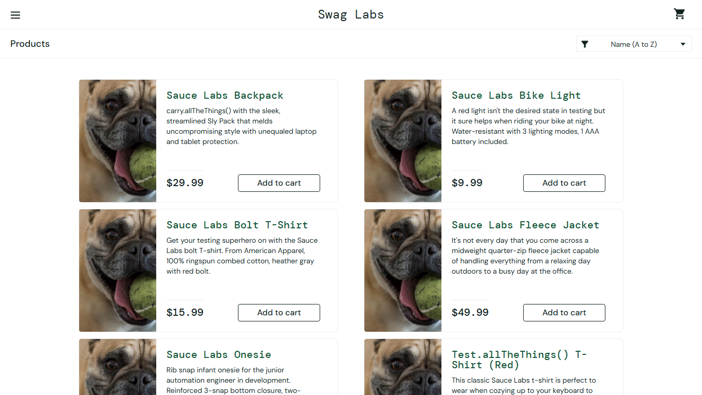

# BUG-004: Every product shows the same placeholder image for problem_user

| Field | Value |
|---|---|
| Severity | Minor |
| Priority | Medium |
| Module | Products |
| Origin | Seeded |
| Status | Open |
| Found in | https://www.saucedemo.com, Chrome (Chromium), 2026-11-05 |
| Test user | `problem_user / secret_sauce` |
| Failed test cases | TC-022 |

## Steps to reproduce
1. Log in as problem_user
2. Look at the images on the Products page

## Expected result
Each product shows its own image.

## Actual result
All six products show one placeholder image.

## Evidence

> Seeded by the site: the practice site builds these failures into the named user so testers can practise reporting them. Logged as if found in a real product.
