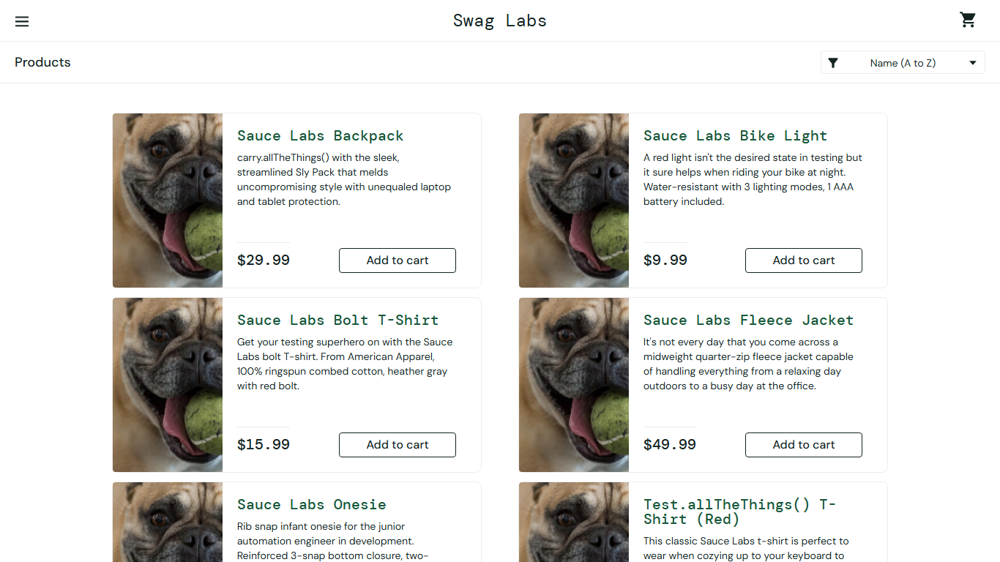

# BUG-005: Sorting has no effect for problem_user

| Field | Value |
|---|---|
| Severity | Major |
| Priority | Medium |
| Module | Sorting |
| Origin | Seeded |
| Status | Open |
| Found in | https://www.saucedemo.com, Chrome (Chromium), 2026-11-05 |
| Test user | `problem_user / secret_sauce` |
| Failed test cases | TC-028 |

## Steps to reproduce
1. Log in as problem_user
2. Choose Name (Z to A) in the sort menu

## Expected result
Products reorder Z to A.

## Actual result
Order stays A to Z.

## Evidence

> Seeded by the site: the practice site builds these failures into the named user so testers can practise reporting them. Logged as if found in a real product.
