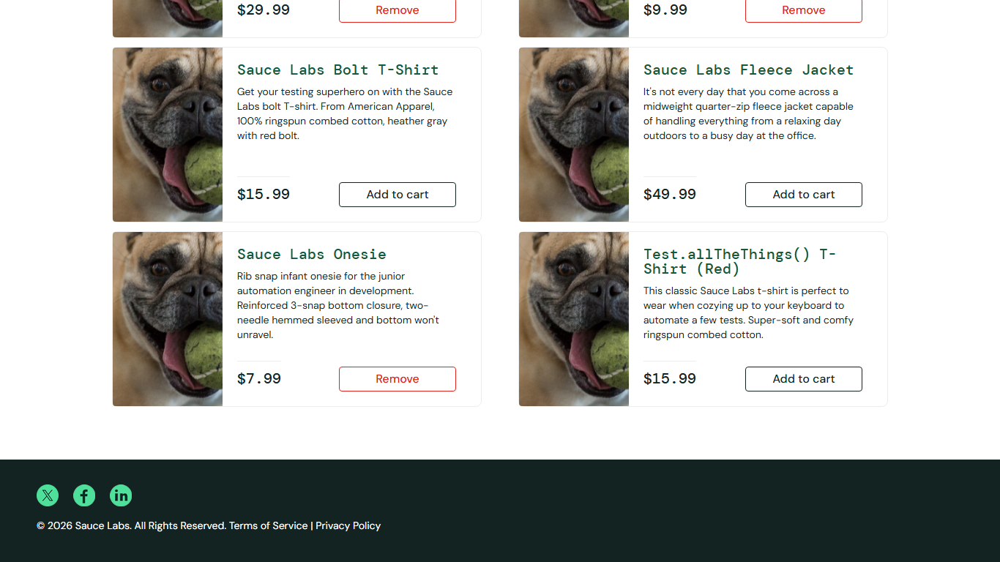

# BUG-006: Add and Remove buttons fail on several products for problem_user

| Field | Value |
|---|---|
| Severity | Critical |
| Priority | High |
| Module | Cart |
| Origin | Seeded |
| Status | Open |
| Found in | https://www.saucedemo.com, Chrome (Chromium), 2026-11-05 |
| Test user | `problem_user / secret_sauce` |
| Failed test cases | TC-035, TC-036 |

## Steps to reproduce
1. Log in as problem_user
2. Click Add to cart on Bolt T-Shirt, Fleece Jacket and Test.allTheThings() T-Shirt
3. Add Backpack, Bike Light and Onesie, then click Remove on each

## Expected result
Add changes the button to Remove; Remove changes it back.

## Actual result
Add does nothing for the first three products. Remove does nothing for the last three.

## Evidence

> Seeded by the site: the practice site builds these failures into the named user so testers can practise reporting them. Logged as if found in a real product.
