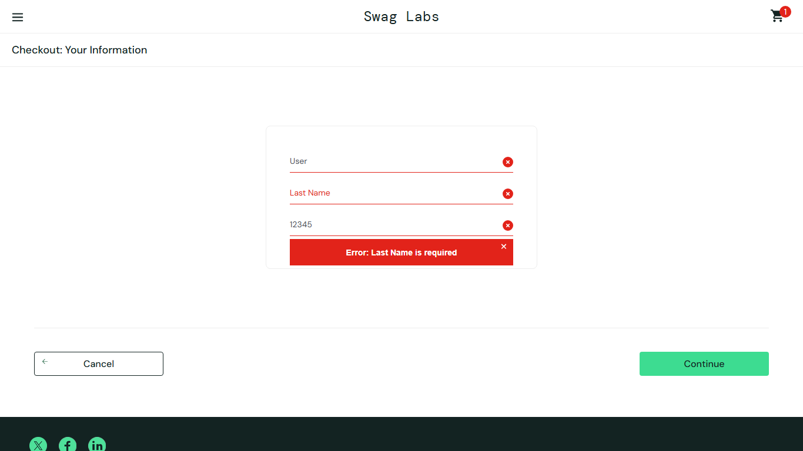

# BUG-007: Last Name text is typed into the First Name field for problem_user

| Field | Value |
|---|---|
| Severity | Critical |
| Priority | High |
| Module | Checkout |
| Origin | Seeded |
| Status | Open |
| Found in | https://www.saucedemo.com, Chrome (Chromium), 2026-11-05 |
| Test user | `problem_user / secret_sauce` |
| Failed test cases | TC-046 |

## Steps to reproduce
1. Log in as problem_user and add Backpack
2. Start checkout
3. Type Test / User / 12345 into the three fields
4. Click Continue

## Expected result
Each field keeps its own value and checkout continues.

## Actual result
Last Name stays empty, First Name shows "User", error "Last Name is required". Checkout cannot be completed.

## Evidence

> Seeded by the site: the practice site builds these failures into the named user so testers can practise reporting them. Logged as if found in a real product.
