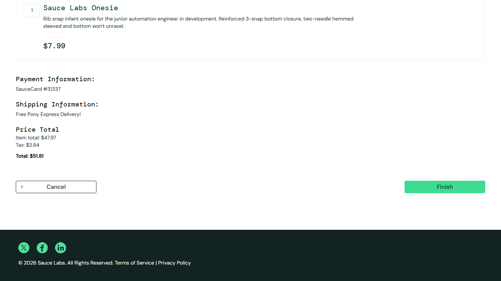

# BUG-010: Order cannot be completed for error_user

| Field | Value |
|---|---|
| Severity | Critical |
| Priority | High |
| Module | Checkout |
| Origin | Seeded |
| Status | Open |
| Found in | https://www.saucedemo.com, Chrome (Chromium), 2026-11-05 |
| Test user | `error_user / secret_sauce` |
| Failed test cases | TC-047 |

## Steps to reproduce
1. Log in as error_user and add a product that can be added
2. Complete checkout details and click Continue
3. Click Finish

## Expected result
Order confirmation page.

## Actual result
Stays on checkout step two; order is not placed.

## Evidence

> Seeded by the site: the practice site builds these failures into the named user so testers can practise reporting them. Logged as if found in a real product.
