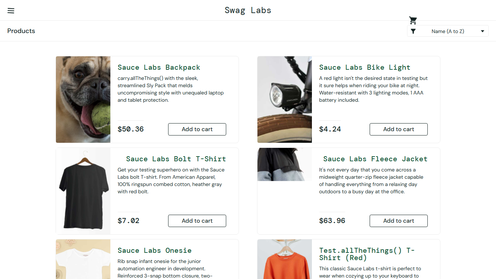

# BUG-011: visual_user sees different prices and a broken layout

| Field | Value |
|---|---|
| Severity | Major |
| Priority | High |
| Module | Products |
| Origin | Seeded |
| Status | Open |
| Found in | https://www.saucedemo.com, Chrome (Chromium), 2026-11-05 |
| Test user | `visual_user / secret_sauce` |
| Failed test cases | TC-023, TC-058 |

## Steps to reproduce
1. Log in as visual_user
2. Compare the Products page with standard_user

## Expected result
Same prices and layout.

## Actual result
Prices differ (Backpack $50.36 vs $29.99, Bike Light $4.24 vs $9.99, Bolt T-Shirt $7.02 vs $15.99, Fleece Jacket $63.96 vs $49.99), cart icon misplaced, titles shifted, Fleece Jacket image cropped.

## Evidence

> Seeded by the site: the practice site builds these failures into the named user so testers can practise reporting them. Logged as if found in a real product.
