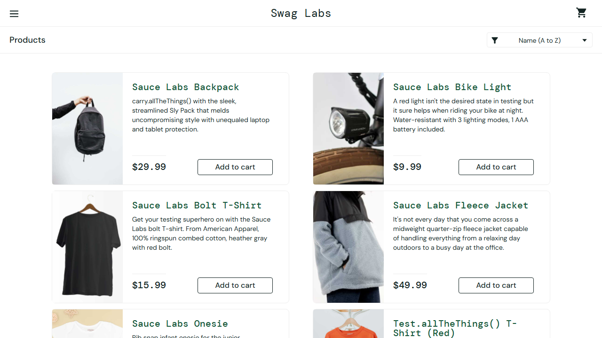

# BUG-013: Login can be bypassed by forging an unsigned session cookie

| Field | Value |
|---|---|
| Severity | Critical |
| Priority | High |
| Module | Security |
| Origin | Genuine |
| Status | Open |
| Found in | https://www.saucedemo.com, Chrome (Chromium), 2026-11-05 |
| Test user | `none (no password needed)` |
| Failed test cases | TC-065, TC-066 |

## Steps to reproduce
1. Open a fresh private window on https://www.saucedemo.com (not logged in)
2. In the browser tools add a cookie for www.saucedemo.com: name session-username, value standard_user, path /
3. Open https://www.saucedemo.com/inventory.html

## Expected result
Redirected to the login page. A session must be proven with a password and be an unguessable, signed value, with HttpOnly and Secure set.

## Actual result
The shop opens as standard_user with no password. The same works for problem_user (and any other username); only locked_out_user is turned away. The cookie holds the plain username, HttpOnly is false, Secure is false, SameSite is Lax, lifetime about 10 minutes.

## Evidence

> Impact if real: anyone who knows or guesses a username can act as that user, and script on the page can read or steal the cookie. Logged as if found in a real product. The practice shop has no server behind its login, so this is how it is built, but a real shop with this behaviour would have the stated impact.
