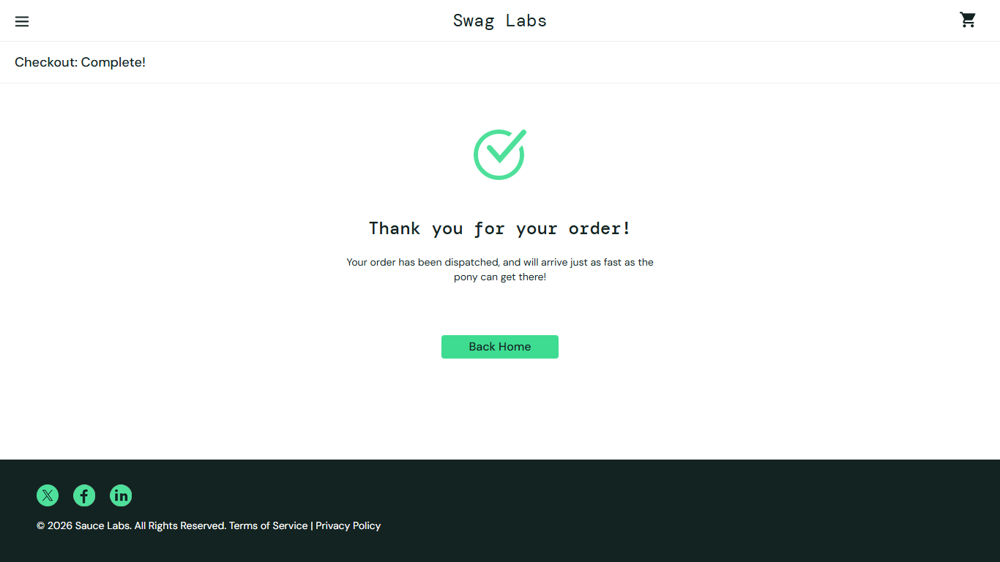

# BUG-014: Order confirmation page can be opened without placing an order

| Field | Value |
|---|---|
| Severity | Major |
| Priority | Medium |
| Module | Checkout |
| Origin | Genuine |
| Status | Open |
| Found in | https://www.saucedemo.com, Chrome (Chromium), 2026-11-05 |
| Test user | `standard_user / secret_sauce` |
| Failed test cases | TC-073 |

## Steps to reproduce
1. Log in as standard_user with an empty cart
2. Open https://www.saucedemo.com/checkout-complete.html directly

## Expected result
Redirected to the cart or products page.

## Actual result
The page shows "Thank you for your order! Your order has been dispatched" although no order exists.

## Evidence

> Impact if real: false confirmation screens, wrong support calls and misleading analytics. Logged as if found in a real product. The practice shop has no server behind its login, so this is how it is built, but a real shop with this behaviour would have the stated impact.
