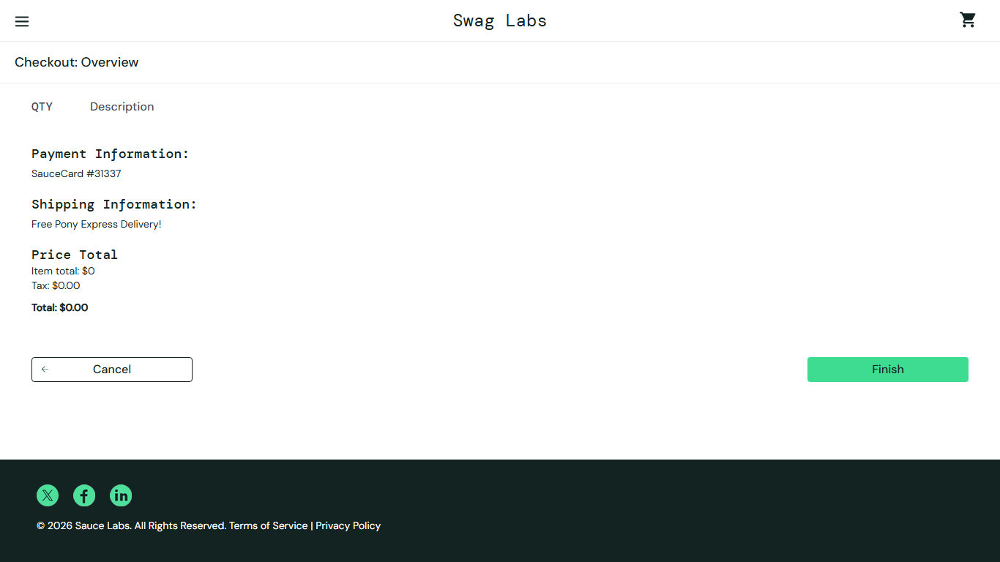

# BUG-015: Checkout overview can be opened with an empty cart and an order can be submitted again with the Back button

| Field | Value |
|---|---|
| Severity | Major |
| Priority | High |
| Module | Checkout |
| Origin | Genuine |
| Status | Open |
| Found in | https://www.saucedemo.com, Chrome (Chromium), 2026-11-05 |
| Test user | `standard_user / secret_sauce` |
| Failed test cases | TC-074, TC-075 |

## Steps to reproduce
A. 1. Log in with an empty cart
   2. Open https://www.saucedemo.com/checkout-step-two.html directly
B. 1. Place a normal order
   2. Click the browser Back button
   3. Click Finish

## Expected result
A: redirected to the cart. B: the overview is not shown again, or Finish does nothing.

## Actual result
A: overview opens with Total $0.00 and a working Finish button. B: the overview returns with Total $0.00 and Finish shows the confirmation again, so a second (empty) order is accepted. Related to BUG-001.

## Evidence

> Impact if real: empty and duplicate orders. Logged as if found in a real product. The practice shop has no server behind its login, so this is how it is built, but a real shop with this behaviour would have the stated impact.
