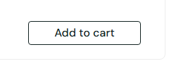

# BUG-016: Keyboard focus is not visible on buttons and the sort menu

| Field | Value |
|---|---|
| Severity | Major |
| Priority | Medium |
| Module | Accessibility |
| Origin | Genuine |
| Status | Open |
| Found in | https://www.saucedemo.com, Chrome (Chromium), 2026-11-05 |
| Test user | `standard_user / secret_sauce` |
| Failed test cases | TC-084 |

## Steps to reproduce
1. Log in as standard_user
2. Press Tab until the Add to cart button of Backpack is focused (or the sort menu)
3. Compare it with an unfocused button

## Expected result
A clear focus indicator is shown (WCAG 2.1 success criterion 2.4.7, level AA).

## Actual result
The focused control looks identical to an unfocused one: computed outline-style none, no box-shadow, no colour change. Keyboard users cannot tell where they are. The automated axe scan does not detect this, it was found by testing with the keyboard.

## Evidence

> Impact if real: the shop is hard or impossible to use for keyboard-only users, which is also a legal risk in many countries. Logged as if found in a real product. The practice shop has no server behind its login, so this is how it is built, but a real shop with this behaviour would have the stated impact.
