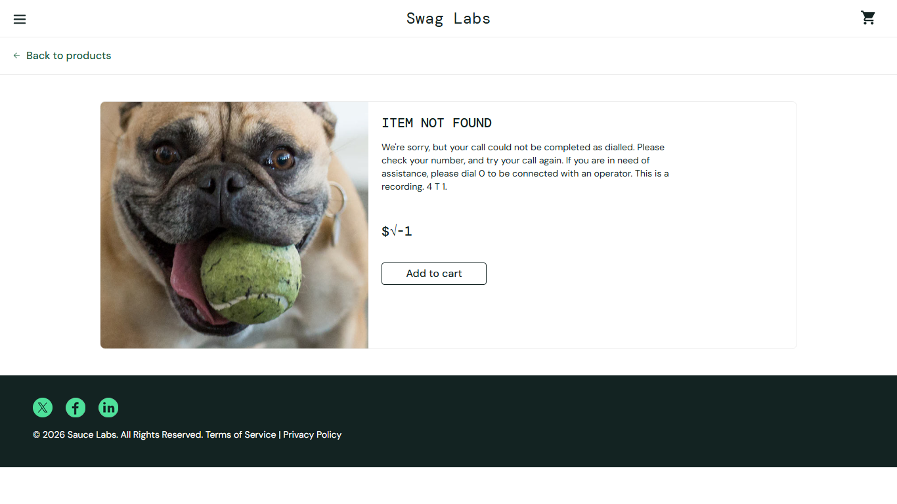

# BUG-019: Unknown addresses show a blank page and the product not-found page uses telephone wording

| Field | Value |
|---|---|
| Severity | Minor |
| Priority | Low |
| Module | Navigation |
| Origin | Genuine |
| Status | Open |
| Found in | https://www.saucedemo.com, Chrome (Chromium), 2026-11-05 |
| Test user | `standard_user / secret_sauce` |
| Failed test cases | TC-072 |

## Steps to reproduce
1. Open https://www.saucedemo.com/nonexistent-page.html
2. Open https://www.saucedemo.com/inventory-item.html?id=999

## Expected result
A plain-language "page not found" message with a link back to the shop.

## Actual result
1: a blank page (HTTP 404, no text). 2: "ITEM NOT FOUND - We're sorry, but your call could not be completed as dialled. Please check your number, and try your call again." (wording for a phone line, not a web shop).

## Evidence

> Impact if real: confusing dead ends for shoppers. Logged as if found in a real product. The practice shop has no server behind its login, so this is how it is built, but a real shop with this behaviour would have the stated impact.
