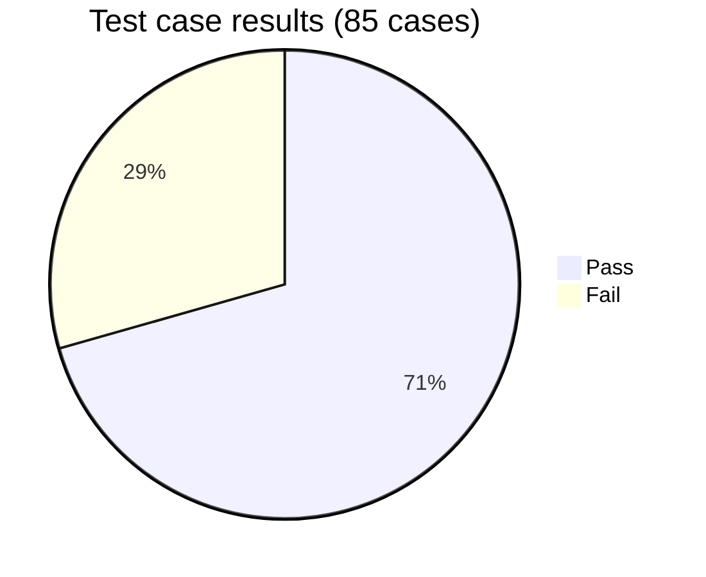
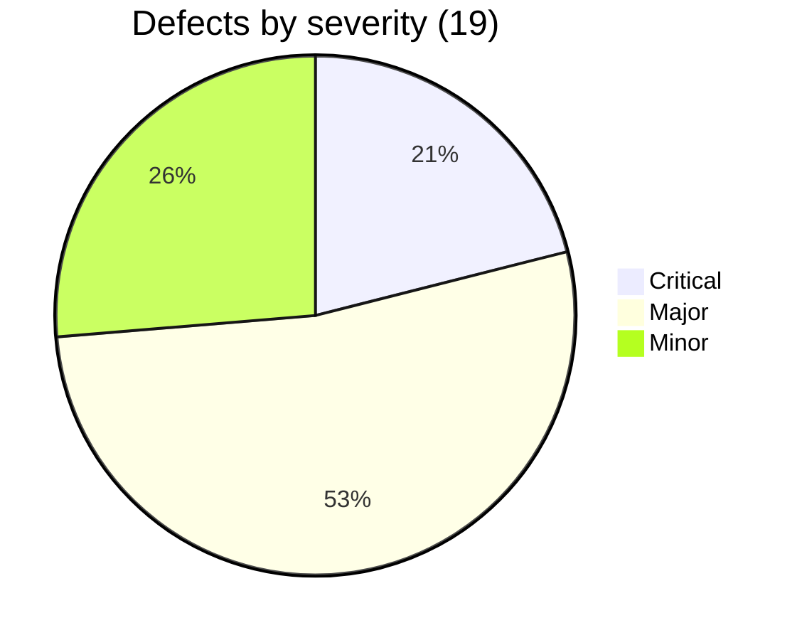

# Test Summary Report: Sauce Demo

| | |
|---|---|
| Application | https://www.saucedemo.com |
| Execution date | 2026-11-05 (two passes: functional pass, then a deeper review of security, URL handling, keyboard use and edge cases) |
| Environment | Chrome (Chromium) 1366x768, 480x640 and 320x640; real Microsoft Edge 156; Firefox and WebKit through the automated suite in CI |
| Report version | 2.0 |

## 1. Executive summary
**Recommendation: not ready for release as a real shop.** The normal shopping path works: login, sorting, cart, correct totals (item total plus 8% tax, checked by hand for 2 and 6 products and in the automated suite for 3) and order completion pass in Chrome, real Edge, and through automation in Firefox and WebKit. An automated accessibility scan of all 7 pages found no violations, including colour contrast. HTTP is redirected to HTTPS.

But three problems block a release:
1. **Login can be bypassed.** The session is an unsigned cookie that holds the plain username. Setting `session-username=standard_user` in a fresh browser opens the shop with no password (BUG-013, Critical).
2. **Checkout integrity is broken.** An empty cart can be checked out (BUG-001), the "Thank you for your order!" page can be opened without an order (BUG-014), and the Back button lets an order be submitted again (BUG-015).
3. **Keyboard users cannot see where they are.** No visible focus indicator (BUG-016, a WCAG AA failure).

The first round of testing missed the login bypass, the false confirmation and the focus problem; the second round found them by going beyond the happy path. Nine more defects appear only for the site's special test users (problem, error, visual, performance_glitch); they are reported to show the full defect process and do not count towards the recommendation.

**Exit rule from the strategy** (no open Critical genuine defect, at most two Major): **not met** (1 Critical and 5 Major genuine defects).

## 2. Results at a glance
| Measure | Value |
|---|---|
| Test cases designed and executed | 85 (100%) |
| Passed | 60 |
| Failed | 25 |
| Not run | 0 |
| Pass rate | 70.6% |
| Defects raised | 19 (10 Genuine, 9 Seeded) |
| Critical / Major / Minor | 4 / 10 / 5 |
| Genuine defects: Critical / Major / Minor | 1 / 5 / 4 |

25 failures come from 19 defects: 14 failures are in the standard-user flow and 11 are specific to the special test users.

## 3. Results by module
| Module | Total | Pass | Fail |
|---|---|---|---|
| Login | 14 | 13 | 1 |
| Session | 4 | 4 | 0 |
| Products | 5 | 3 | 2 |
| Sorting | 7 | 4 | 3 |
| Cart | 11 | 7 | 4 |
| Checkout | 10 | 4 | 6 |
| Order | 7 | 7 | 0 |
| Navigation | 2 | 2 | 0 |
| UI | 4 | 3 | 1 |
| Accessibility | 6 | 5 | 1 |
| Compatibility | 4 | 4 | 0 |
| Security | 6 | 3 | 3 |
| URL handling | 5 | 1 | 4 |

## 4. Requirement coverage
Every requirement has test cases (no gaps). Details in the workbook, sheet "Traceability".

| Req | Area | Cases | Pass | Fail |
|---|---|---|---|---|
| REQ-01 | Authentication | 13 | 12 | 1 |
| REQ-02 | Session & access | 4 | 4 | 0 |
| REQ-03 | Catalogue | 4 | 2 | 2 |
| REQ-04 | Sorting | 7 | 4 | 3 |
| REQ-05 | Cart | 11 | 7 | 4 |
| REQ-06 | Checkout information | 8 | 3 | 5 |
| REQ-07 | Order calculation | 4 | 4 | 0 |
| REQ-08 | Order completion | 3 | 2 | 1 |
| REQ-09 | Navigation | 4 | 4 | 0 |
| REQ-10 | Responsive UI | 4 | 3 | 1 |
| REQ-11 | Accessibility | 8 | 7 | 1 |
| REQ-12 | Browser compatibility | 4 | 4 | 0 |
| REQ-13 | Security hardening | 6 | 3 | 3 |
| REQ-14 | URL handling and navigation state | 5 | 1 | 4 |

## 5. Defects
### Genuine (standard-user flow)
| ID | Title | Severity |
|---|---|---|
| [BUG-013](../defects/BUG-013.md) | Login can be bypassed by forging an unsigned session cookie | **Critical** |
| [BUG-001](../defects/BUG-001.md) | Checkout can be started and completed with an empty cart | Major |
| [BUG-002](../defects/BUG-002.md) | Checkout form has no validation beyond "required" | Major |
| [BUG-014](../defects/BUG-014.md) | Order confirmation page can be opened without placing an order | Major |
| [BUG-015](../defects/BUG-015.md) | Empty-cart overview reachable; Back button allows a repeat order | Major |
| [BUG-016](../defects/BUG-016.md) | Keyboard focus is not visible | Major |
| [BUG-003](../defects/BUG-003.md) | Reset App State leaves buttons on "Remove" | Minor |
| [BUG-017](../defects/BUG-017.md) | Chosen sort order is lost after viewing a product | Minor |
| [BUG-018](../defects/BUG-018.md) | No standard security headers | Minor |
| [BUG-019](../defects/BUG-019.md) | Blank 404 page and telephone wording on product not-found | Minor |

### Seeded (special test users)
| ID | Title | Severity |
|---|---|---|
| [BUG-006](../defects/BUG-006.md) | problem_user: Add/Remove fail on several products | Critical |
| [BUG-007](../defects/BUG-007.md) | problem_user: last name typed into first name | Critical |
| [BUG-010](../defects/BUG-010.md) | error_user: order cannot be completed | Critical |
| [BUG-005](../defects/BUG-005.md) | problem_user: sorting has no effect | Major |
| [BUG-008](../defects/BUG-008.md) | error_user: sorting shows error alert | Major |
| [BUG-009](../defects/BUG-009.md) | error_user: Add to cart fails on two products | Major |
| [BUG-011](../defects/BUG-011.md) | visual_user: wrong prices and broken layout | Major |
| [BUG-012](../defects/BUG-012.md) | performance_glitch_user: product list appears about 5 s after login | Major |
| [BUG-004](../defects/BUG-004.md) | problem_user: same image on every product | Minor |

## 6. What works well
- Pricing: item total, 8% tax and grand total are correct for 2 and 6 products by hand, and for 3 in the automated suite.
- Login: eight invalid-input variants are all rejected with clear messages; passwords are masked; injection text gives only a generic error.
- Access control for pages: opening `/inventory.html` without a session, and the Back button after logout, are both blocked.
- Product URLs: script text or an unknown id in the address does not run code or crash the page.
- Transport: plain HTTP redirects to HTTPS.
- Accessibility basics: automated scan clean on all 7 pages; logical tab order; Enter adds to cart; Escape closes the menu; no horizontal scroll at 320 or 480 px.
- Browsers: full purchase works in Chrome and real Edge 156; automated suite passes on Firefox and WebKit.

## 7. Risks and limitations
1. **Firefox and WebKit were verified by the automated suite, not by hand** (CI run 41989789403). WebKit is Safari's engine, but Safari on macOS and iOS itself was not available.
2. **Accessibility** was checked with an automated scanner and keyboard testing. No screen reader (NVDA, VoiceOver) was used, so announcements and reading order are untested.
3. **Session expiry** was read from the cookie (about 10 minutes) but not waited out.
4. **Performance** is covered in the separate performance-testing project. Login timing was measured for two users; a first timing of performance_glitch_user missed its 5-second delay and was corrected (BUG-012).
5. **The practice site has no server behind login.** Several findings (BUG-013, 014, 015, 018) describe how the site is built, and are written up as they would be for a real shop.

## 8. Recommendations
1. **Fix BUG-013 first:** issue a server-side, signed, HttpOnly and Secure session token after a real password check.
2. **Protect checkout state (BUG-001, 014, 015):** the server must check that the cart has items before showing the overview, accept an order only once, and show confirmation only for a real order.
3. **Add validation (BUG-002):** postal code format, trimmed whitespace, length limits, output encoding.
4. **Fix focus visibility (BUG-016):** add a clear `:focus-visible` style to buttons, links and the sort menu.
5. **Add security headers (BUG-018)** and helpful error pages (BUG-019).
6. Re-run the failed cases after fixes. The UI and API automation projects already hold regression tests for the main checks.
7. Run a screen-reader pass and test Safari on a real Apple device before sign-off.

## 9. How the evidence was produced
The test steps are written for a human tester. In this session they were executed in real browsers driven by scripts, so every actual result and screenshot is real and repeatable; nothing was assumed. Screenshots are in [`evidence/`](../evidence). The Excel workbook and CSV files are regenerated from `tools/suite-data.js` with `npm run build`.
