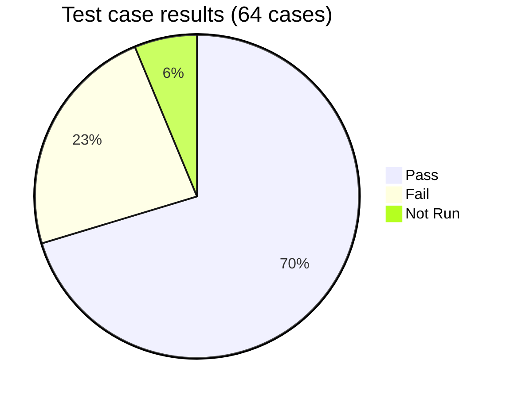
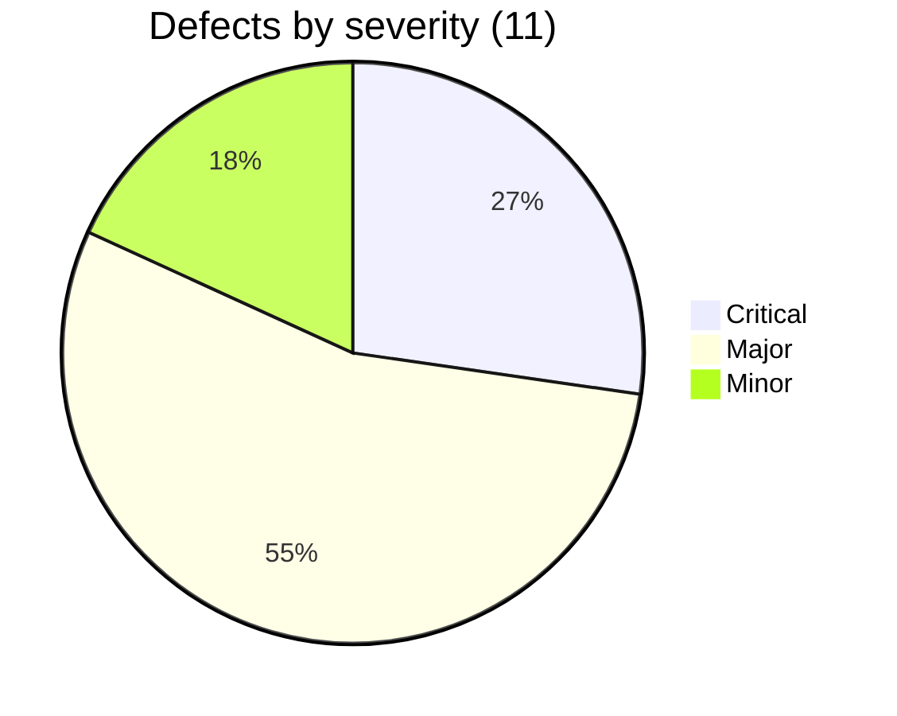

# Test Summary Report: Sauce Demo

| | |
|---|---|
| Application | https://www.saucedemo.com |
| Execution date | 2026-11-05 |
| Environment | Chrome (Chromium), 1366x768 and 375x667 |
| Report version | 1.0 |

## 1. Executive summary
Core purchasing works for the standard user: login, sorting, cart, correct totals (item total + 8% tax) and order completion all pass. Three genuine defects exist in the standard flow, two of them Major: **checkout accepts an empty cart** (BUG-001) and **checkout accepts invalid data** (BUG-002). Eight further defects appear only for the site's special test users (problem, error, visual) and are reported to show the full defect process.

**Recommendation: conditional go.** The exit rule (no Critical genuine defect, at most two Major) is met, but BUG-001 should be fixed before release because it allows zero-value orders.

## 2. Results at a glance
| Measure | Value |
|---|---|
| Test cases designed | 64 |
| Executed | 60 (93.8%) |
| Passed | 45 |
| Failed | 15 |
| Not run | 4 (Firefox, Edge, Safari, contrast analyser) |
| Pass rate of executed | 75.0% |
| Defects raised | 11 (3 Genuine, 8 Seeded) |
| Critical / Major / Minor | 3 / 6 / 2 |

15 failures come from 11 defects; five failures are in the standard-user flow (BUG-001, BUG-002 x3, BUG-003) and ten are persona-specific.

## 3. Results by module
| Module | Total | Pass | Fail | Not Run |
|---|---|---|---|---|
| Login | 14 | 14 | 0 | 0 |
| Session | 4 | 4 | 0 | 0 |
| Products | 5 | 3 | 2 | 0 |
| Sorting | 6 | 4 | 2 | 0 |
| Cart | 8 | 4 | 4 | 0 |
| Checkout | 10 | 4 | 6 | 0 |
| Order | 6 | 6 | 0 | 0 |
| Navigation | 2 | 2 | 0 | 0 |
| UI | 3 | 2 | 1 | 0 |
| Accessibility | 2 | 1 | 0 | 1 |
| Compatibility | 4 | 1 | 0 | 3 |

## 4. Requirement coverage
Every requirement has test cases (no gaps). Details in the workbook, sheet "Traceability".

| Req | Area | Cases | Pass | Fail | Not Run |
|---|---|---|---|---|---|
| REQ-01 | Authentication | 13 | 13 | 0 | 0 |
| REQ-02 | Session & access | 4 | 4 | 0 | 0 |
| REQ-03 | Catalogue | 4 | 2 | 2 | 0 |
| REQ-04 | Sorting | 6 | 4 | 2 | 0 |
| REQ-05 | Cart | 8 | 4 | 4 | 0 |
| REQ-06 | Checkout information | 8 | 3 | 5 | 0 |
| REQ-07 | Order calculation | 3 | 3 | 0 | 0 |
| REQ-08 | Order completion | 3 | 2 | 1 | 0 |
| REQ-09 | Navigation | 4 | 4 | 0 | 0 |
| REQ-10 | Responsive UI | 3 | 2 | 1 | 0 |
| REQ-11 | Accessibility | 4 | 3 | 0 | 1 |
| REQ-12 | Compatibility | 4 | 1 | 0 | 3 |

## 5. Defects
| ID | Title | Severity | Origin |
|---|---|---|---|
| [BUG-001](../defects/BUG-001.md) | Checkout can be started and completed with an empty cart | Major | Genuine |
| [BUG-002](../defects/BUG-002.md) | Checkout form has no validation beyond "required" | Major | Genuine |
| [BUG-003](../defects/BUG-003.md) | Reset App State leaves buttons on "Remove" | Minor | Genuine |
| [BUG-004](../defects/BUG-004.md) | problem_user: same image on every product | Minor | Seeded |
| [BUG-005](../defects/BUG-005.md) | problem_user: sorting has no effect | Major | Seeded |
| [BUG-006](../defects/BUG-006.md) | problem_user: Add/Remove fail on several products | Critical | Seeded |
| [BUG-007](../defects/BUG-007.md) | problem_user: last name typed into first name | Critical | Seeded |
| [BUG-008](../defects/BUG-008.md) | error_user: sorting shows error alert | Major | Seeded |
| [BUG-009](../defects/BUG-009.md) | error_user: Add to cart fails on two products | Major | Seeded |
| [BUG-010](../defects/BUG-010.md) | error_user: order cannot be completed | Critical | Seeded |
| [BUG-011](../defects/BUG-011.md) | visual_user: wrong prices and broken layout | Major | Seeded |

## 6. Risks and limitations
1. **Browser coverage is incomplete.** Only Chrome was run. Firefox, Edge and Safari remain unverified.
2. **Accessibility is partial.** No contrast analyser or screen reader was used; keyboard testing covered the login form only.
3. **Script text in checkout** was accepted. Whether it is encoded when displayed was not examined, so a stored-XSS risk cannot be ruled out.
4. **Performance** was not measured here (see the performance-testing project). The only timing was login for two users.
5. **Open product questions:** cart persistence after logout, Cancel destination, page titles (see test plan section 6).

## 7. Recommendations
1. Fix BUG-001: block checkout when the cart is empty, on both page and server.
2. Fix BUG-002: validate ZIP format, trim whitespace, set field length limits, encode output.
3. Fix BUG-003: re-render product buttons from cart state on reset.
4. Run the Firefox, Edge and Safari smoke subset (TC-062 to TC-064) and a contrast check before sign-off.
5. Convert the passing regression cases to automation (done in the `automation-testing` project).

## 8. How the evidence was produced
The test steps are written for a human tester. In this session they were executed in a real Chrome-based browser driven by scripts so that every actual result and screenshot is real and repeatable; nothing was assumed. Screenshots are in [`evidence/`](../evidence). The Excel workbook and CSV files are regenerated from `tools/suite-data.js` with `npm run build`.
