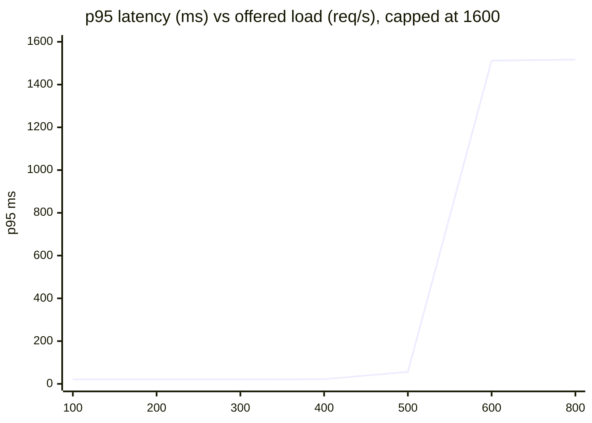

# Performance Test Summary: Demo Shop API

| | |
|---|---|
| System under test | Demo shop API (`sut/server.js`), 4-connection database pool, 1.5 s queue timeout |
| Run date | 2026-11-05 |
| Tool | k6 2.3.0 (open workload model, fixed arrival rate) |
| Machine | Intel Core i7-7500U, 4 logical cores, 3.9 GB RAM, Windows 10. Load generator and target share it |
| Full numbers | [results/REPORT.md](../results/REPORT.md), [results/report.html](../results/report.html) (download and open), raw JSON per test in `results/` |

## 1. Executive summary
At normal traffic the shop is fast: **p95 21 ms and 0% errors at 150 req/s**, against a target of 300 ms. It can carry **about 500 req/s** within its targets, roughly **3.3 times the planned load**. Above that it **hits a cliff, not a slope**: at 500 req/s p95 is 56 ms, at 600 req/s it is 1,512 ms with 9.7% errors, and at 800 req/s 37% of requests fail.

The cause is the small database pool. When all 4 connections are busy, requests queue and give up after 1.5 s with a 503. That keeps the service alive, and it **recovers fully** once traffic drops, but customers see slow pages and failed orders during any surge above about 500 req/s.

**Verdict:** meets its targets for expected traffic and for long steady use; **not ready for a surge above 500 req/s** without changes (see recommendations).

## 2. Results
| Test | Result | Key numbers |
|---|---|---|
| Smoke | PASS | 63 requests, p95 33 ms, 0 errors |
| Load (150 req/s) | PASS | 11,999 requests, p95 21 ms, p99 34 ms, 0 errors |
| Stress | Breaking point found | Healthy to 500 req/s, degraded from 600 |
| Spike (50 to 800 req/s) | PASS (baseline and recovery met targets) | During spike p95 1,516 ms, 32.9% errors; recovered afterwards |
| Soak (4 min, 100 req/s) | PASS | p95 21 ms start and end (-0.2%), heap 5.56 to 5.53 MB |
| Public baseline (JSONPlaceholder, 5 users) | PASS | 250 requests, p95 361 ms, 0 errors |

## 3. Stress: the breaking point
| Offered | Achieved | p95 | Errors | Status |
|---|---|---|---|---|
| 100/s | 99.9/s | 21 ms | 0% | ok |
| 200/s | 197.9/s | 21 ms | 0% | ok |
| 300/s | 297.9/s | 21 ms | 0% | ok |
| 400/s | 397.9/s | 22 ms | 0% | ok |
| **500/s** | 497.9/s | **56 ms** | 0% | ok, but latency has started to climb |
| 600/s | 591.8/s | 1,512 ms | 9.7% | **degraded** |
| 800/s | 779.8/s | 1,517 ms | 37.0% | **degraded** |
| 100/s after overload (first 8 s) | 146/s | 1,512 ms | 13.9% | backlog still clearing |
| 100/s recovered | 100/s | 21 ms | 0% | back to normal |

What the numbers say:
- Latency is flat until about 400 req/s, then the first sign of queuing appears at 500 (2.5x higher), then the cliff at 600. Treat **about 400 to 450 req/s as the safe operating limit** and 500 as the edge, not as a comfortable target.
- Past the limit the latency settles at about 1.5 s because that is the queue timeout; slow requests turn into 503 errors. The system **fails fast and stays up**.
- After the overload the system needed several seconds to clear its backlog (errors continued in the first 8 s) and was fully normal in the following 20 s.

## 4. Spike
| Phase | Offered | p95 | Errors |
|---|---|---|---|
| Baseline | 50/s | 21 ms | 0% |
| Spike | 800/s | 1,516 ms | 32.9% |
| First 8 s after | 50/s | 1,521 ms | 30.8% |
| Recovered | 50/s | 21 ms | 0% |

A sudden jump 60% above capacity causes about a third of requests to fail for the duration of the spike and for a few seconds after it. There is no lasting damage.

## 5. Soak
Over 4 minutes at 100 req/s: latency identical in the first and last third (21 ms), heap after garbage collection flat (5.56 to 5.53 MB). **No leak or slow degradation in this window.** This is a short demonstration; a real soak runs for hours (`SCALE=30` gives 2 hours).

## 6. Recommendations (for this system)
1. **Raise or tune the connection pool.** Capacity is almost exactly pool size divided by average query time; this is the bottleneck.
2. **Cache the product list and product detail.** They are 90% of traffic and rarely change; caching removes most database calls.
3. **Add load shedding sooner.** A 1.5 s queue wait guarantees every overloaded request is slow *and* then fails. A shorter wait (for example 300 ms) fails fast and keeps the requests that are served quick.
4. **Index or externalise search.** It burns CPU on the event loop on every call and is the slowest read endpoint.
5. **Autoscale or rate-limit before 450 req/s**, the practical safe limit found here.

## 7. Limitations (please read)
- **Simulated target.** The latencies and the pool are a model of a typical web app, not a real production system. The *behaviour pattern* (flat, then cliff, fail-fast, recovery) and the *method* transfer; the exact 500 req/s figure does not.
- **Shared machine.** k6 and the target run on one 2-core laptop. At the highest steps k6 dropped about 550 to 580 iterations because it could not start them fast enough, so the 600 and 800 req/s rows slightly understate the offered load.
- **One run.** Single-run figures; repeat before trusting small differences. Healthy-range numbers (about 21 ms) were identical across three separate runs.
- **Short soak** (4 min), so slow leaks could be missed.
- The public API test is deliberately tiny (5 users, 30 s) so as not to burden a free third-party service.
